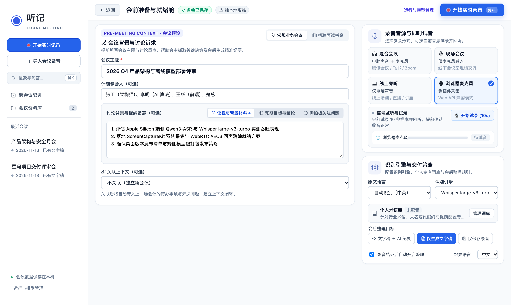
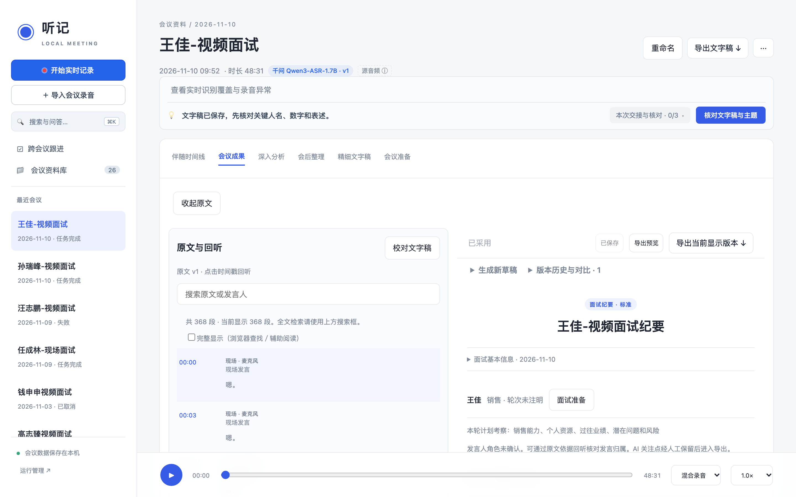
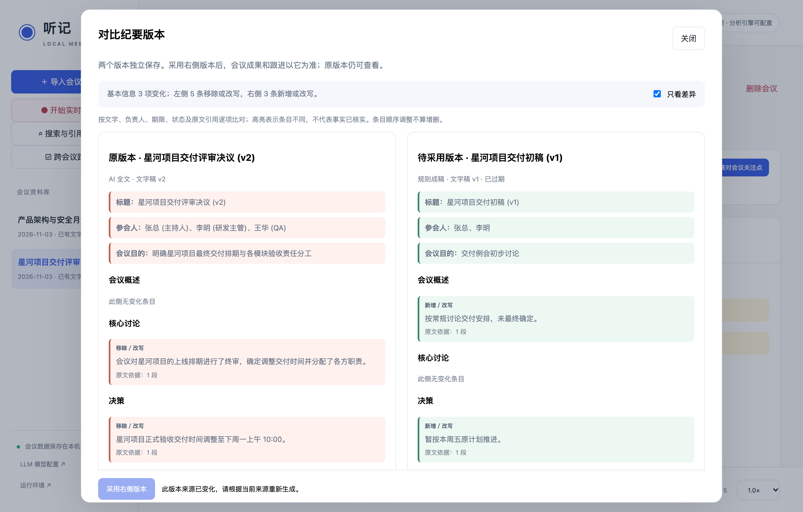
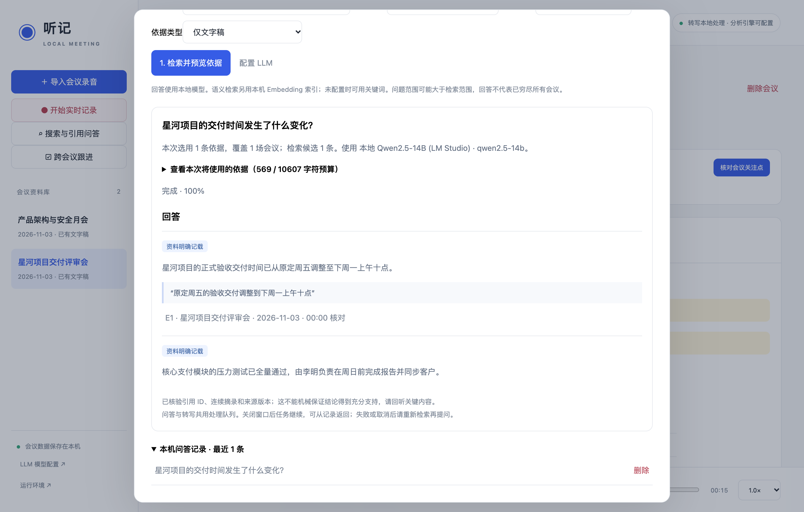

# 听记 · 本地会议工作台 (Meeting-Local)

> **基于 Apple Silicon 的端侧优先（Local-First）智能会议工作台**  
> 纯离线双引擎语音识别 · macOS 原生双音轨内录 · 严格防幻觉溯源校验 · 本地向量 RAG · 跨会议引用问答 · 打印级公文导出

---

## 目录

- [一、核心定位与特性](#一核心定位与特性)
- [📸 典型界面预览](#-典型界面预览)
- [二、系统架构与数据流](#二系统架构与数据流)
- [三、运行环境与硬件要求](#三运行环境与硬件要求)
- [四、一键安装与部署指南](#四一键安装与部署指南)
  - [1. 基础环境与核心引擎安装](#1-基础环境与核心引擎安装)
  - [2. 千问 MLX 双引擎环境配置（可选）](#2-千问-mlx-双引擎环境配置可选)
  - [3. macOS 原生双音轨采集器构建](#3-macos-原生双音轨采集器构建)
  - [4. 内置中文向量检索模型就绪](#4-内置中文向量检索模型就绪)
  - [5. 启动与日常运行](#5-启动与日常运行)
- [五、核心工作流与功能指引](#五核心工作流与功能指引)
  - [1. 会前准备与历史待办承接](#1-会前准备与历史待办承接)
  - [2. 录音工作台与实时增量流式识别](#2-录音工作台与实时增量流式识别)
  - [3. 快速出稿与精细重转写](#3-快速出稿与精细重转写)
  - [4. 超长文稿校对与动态虚拟滚动](#4-超长文稿校对与动态虚拟滚动)
  - [5. 会中简记扩写与原文连续引用核验](#5-会中简记扩写与原文连续引用核验)
  - [6. 同屏多维核对与多版本纪要生成](#6-同屏多维核对与多版本纪要生成)
  - [7. 线上面试纪要专版](#7-线上面试纪要专版)
  - [8. 交付版本冻结与专业打印排版导出](#8-交付版本冻结与专业打印排版导出)
  - [9. 基于 sqlite-vec 的本地跨会议 RAG 与引用问答](#9-基于-sqlite-vec-的本地跨会议-rag-与引用问答)
- [六、LLM 大模型接入配置](#六llm-大模型接入配置)
- [七、前端开发与构建](#七前端开发与构建)
- [八、工程自动化验证](#八工程自动化验证)
- [九、数据主权、安全与隐私设计](#九数据主权安全与隐私设计)
- [十、开源模型与组件来源许可](#十开源模型与组件来源许可)

---

## 一、核心定位与特性

`meeting-local` 是一款深度针对 Apple Silicon（Metal / MLX）架构构建的高可信、本地优先会议工作台。它克服了纯云端会议工具的数据隐私担忧，也超越了纯实验性工具在长会议中容易 OOM、幻觉编造、缺乏排版能力的短板。

### 核心亮点

1. **100% 数据主权与本地算力优先**：
   - 录音采集、语音转写、声纹聚类、标点恢复、本地向量索引与断点恢复**全程在设备端本地离线完成**，默认监听 `127.0.0.1`，数据库设为仅用户自身可读写（`0o600`）。
2. **Apple Silicon 双 ASR 推理引擎**：
   - **Whisper 体系**：`whisper.cpp` + Metal GPU 加速，搭载 `large-v3-turbo`，配搭 Silero VAD 与 CT-Transformer 标点恢复。
   - **Qwen3 MLX 体系**：`Qwen3-ASR-1.7B (8-bit)` + `Qwen3-ForcedAligner-0.6B (8-bit)`，原生 MLX GPU 加速，支持真实字词级时间戳对齐，且具备对齐越界自动降级与递归二分自愈能力。
3. **原生 macOS 双音轨内录与容灾机制**：
   - 基于 macOS 15+ **ScreenCaptureKit** 编译的原生采集器，支持“电脑声音 + 麦克风”独立音轨采集，并按统一时间线消除暂停空隙；
   - 录音期间 `caffeinate -di` 与 Screen Wake Lock 防休眠保活；
   - 前端 IndexedDB 5 秒分段暂存 + 后端原子落盘，无惧断电与意外关窗。
4. **极致严谨的防幻觉溯源机制（Ground-Truth Grounding）**：
   - 所有的简记扩写、行动项、决策结论与跨会议回答**必须绑定真实原文片段（Segment ID）及逐字连续子串摘录（Continuous Quote）**；
   - 底层文字稿修改后，下游派生结果立即级联失效（Stale），杜绝虚假事实扩散。
5. **基于 `sqlite-vec` 的端侧跨会议 RAG 检索与问答**：
   - 内置量化版 **`bge-small-zh-v1.5` INT8 ONNX** 模型，免除对外部 Embedding 服务的依赖；
   - 提供关键词、向量语义与 RRF 混合检索；支持多会议资料提炼并生成带来源编号的可回听引用回答。
6. **公文级排版与交付版本冻结（Frozen Delivery）**：
   - 纪要支持多版本同屏字段级差异高亮（Diff）；
   - 一旦核准即可“保存交付版本”，物理固化当时的文字稿、纪要与执行人状态快照；
   - 原生支持 Markdown、SRT、标准 Word（`.docx` 表格/样式）以及 ReportLab 矢量级 A4 **PDF 打印排版**（带页眉页脚、跨页表头与证据附录）。

---

## 📸 典型界面预览

### 1. 实时录音与边录边记工作台
> 麦克风 / 系统内录双音轨独立采集 · Qwen/Whisper 流式增量转写 · 快捷打点（`Alt+M`）· 会议重点与个人备注隔离 · 5 秒暂存与防休眠保活



### 2. 会后双侧核对与事实核准
> 左侧原文带声纹分段与毫秒级时间戳 · 点击任意句即刻回听原音 · 右侧现场关注核对流 · 逐项核验并决定纳入纪要、待办或暂存



### 3. 结构化会议成果与不可变交付版本留档
> 多风格公文规范排版 · 决议与行动项（责任人/截止期/追踪状态）· 交付冻结不可篡改快照 · 一键导出打印级 Word 与矢量 PDF


### 4. 纪要多版本独立演进与双栏对比
> AI 全文整理稿与人工修改稿独立保存 · 双栏可视化 Diff 对比 · 自动检测基本信息、删除、新增与改写高亮 · 来源变更级联防护



### 5. 本地跨会议 RAG 与严格引用问答
> 纯本地 BGE 向量模型检索 · 先预览证据快照再调用模型 · 回答强制绑定连续原文摘录与来源编号 · 点击即刻回听证据片段



---

## 二、系统架构与数据流

```text
 ┌─────────────────────────────────────────────────────────────────────────────┐
 │                           前端表现层 (React 19 + TypeScript)                │
 │ 录音工作台(双音轨波形) │ 虚拟化长文稿(10k段) │ 同屏核对(左文右稿) │ 差异比对 │ 交付归档 │
 └──────────────────────────────────────┬──────────────────────────────────────┘
                                        │ 本地回环通信 (127.0.0.1:8765)
 ┌──────────────────────────────────────▼──────────────────────────────────────┐
 │                      应用控制与网关层 (FastAPI + Middleware)                │
 │ • 本地回环检查 (Host/Origin 校验)  • 静态前端托管 (零 Node 依赖)             │
 │ • 会议工作区偏好恢复 (Local Storage) • 诊断脱敏过滤                         │
 └──────────────────────────────────────┬──────────────────────────────────────┘
                                        │
 ┌──────────────────────────────────────▼──────────────────────────────────────┐
 │                  调度中心与资源互斥队列 (app/worker.py)                     │
 │ • fcntl 文件排他锁   • 单 Worker 串行 FIFO 队列   • 细粒度 Checkpoint 恢复   │
 │ • 统一内存互斥调度：ASR / 声纹 / 纪要生成 / 向量索引 抢占排队                │
 └──────┬───────────────────────┬──────────────────────┬───────────────────────┘
        │                       │                      │
 ┌──────▼─────────────┐  ┌──────▼─────────────┐  ┌─────▼───────────────────────┐
 │ 采集与保活引擎     │  │  ASR / 声纹推理栈  │  │ 认知理解与本地 RAG 栈       │
 │ • ScreenCaptureKit │  │ • Whisper.cpp      │  │ • BGE-small-zh-v1.5 INT8   │
 │   Swift 原生采集器 │  │   (Metal GPU)      │  │   (内置 CPU ONNX)           │
 │ • caffeinate -di   │  │ • Qwen3-ASR/Aligner│  │ • sqlite-vec 向量检索       │
 │   Mac 系统级防休眠 │  │   (MLX 独立环境)   │  │ • LM Studio 原生接口        │
 │ • IndexedDB 5s 暂存│  │ • Sherpa-ONNX 声纹 │  │   (reasoning=off / 12k tok) │
 └────────────────────┘  └────────────────────┘  └─────────────────────────────┘
                                        │
 ┌──────────────────────────────────────▼──────────────────────────────────────┐
 │                  持久化数据底座 (SQLite WAL, Schema v19)                    │
 │ meetings / revisions / artifacts / meeting_reviews / live_asr_ranges        │
 │ meeting_preparation / meeting_briefs / attention_reviews / note_todos       │
 │ minutes_selection (采用指针) / minutes_deliveries (冻结归档)                │
 └─────────────────────────────────────────────────────────────────────────────┘
```

---

## 三、运行环境与硬件要求

- **操作系统**：macOS 14 (Sonoma) 或 **macOS 15+ (Sequoia，推荐，原生双音轨采集需 macOS 15+)**
- **芯片架构**：Apple Silicon（M1 / M2 / M3 / M4 系列芯片，推荐 16GB 及以上统一内存）
- **软件依赖**：
  - Python 3.12 或 Python 3.13
  - Xcode 命令行开发工具（`xcode-select --install`）
  - Homebrew 管理的 `ffmpeg`（用于音频格式标准化：`brew install ffmpeg`）
  - （可选）若需参与前端开发需 Node.js 20+；**日常使用无需安装 Node.js**（发布包已预编译静态资源）。

---

## 四、一键安装与部署指南

### 1. 基础环境与核心引擎安装

克隆代码仓库后，执行基础初始化脚本：

```bash
git clone https://github.com/your-username/meeting-local.git
cd meeting-local

# 安装主 Python 虚拟环境、编译 whisper.cpp(Metal) 并下载 Whisper、声纹和标点模型
bash scripts/setup.sh
```

`setup.sh` 将自动完成：
1. 校验 `ffmpeg` 与 Python 环境，创建 `.venv` 并安装依赖锁定包；
2. 拉取固定版本的 `whisper.cpp` 源码并编译为 Metal GPU 后端程序；
3. 下载并验证 Whisper large-v3-turbo、Silero VAD、Pyannote 声纹分离、3D-Speaker 嵌入与 CT-Transformer 中文标点恢复模型；
4. 校验全部模型权重 SHA-256 哈希值。

### 2. 千问 MLX 双引擎环境配置（可选）

如需使用 Qwen3-ASR 1.7B 与 ForcedAligner 字词对齐引擎：

```bash
bash scripts/setup_qwen.sh
```

该脚本将创建物理隔离的 `.venv-qwen` 环境，安装 `mlx` 与 `mlx-audio`，并下载 8-bit 量化权重。该环境在推理时强制设置 `HF_HUB_OFFLINE=1`，确保不发生外网访问。

### 3. macOS 原生双音轨采集器构建

在配备 macOS 15+ 的 Mac 上构建原生系统音频与麦克风采集工具：

```bash
bash scripts/build_capture.sh
```

采集器将被编译并代码签名至 `~/Library/Caches/cn.seeknow.tingji/TingjiCapture.app`（放置在本地 Cache 目录可规避云盘同步导致的签名失效）。首次使用时，macOS 会提示授予“屏幕与系统音频录制”及“麦克风”权限。

### 4. 内置中文向量检索模型就绪

项目已完全内置 BAAI 的 `bge-small-zh-v1.5`（ONNX INT8）本地模型支持。首次启动后，在侧边栏**“搜索与引用问答 → 资料搜索 → 本地语义索引”**中点击**“下载安装模型”**（约 24MB），即可一键激活本地向量检索，无需配置外部向量服务。

如在离线断网电脑部署，可在有网设备打包后通过页面一键导入：
```bash
PYTHONPATH=. .venv/bin/python scripts/embedding_model.py pack --output bge-small-zh.zip
```

### 5. 启动与日常运行

日常录音建议使用独立服务入口，或在 Finder 中双击 `service.command`：

```bash
./service.command start
./service.command status
./service.command stop
```

浏览器打开 `http://127.0.0.1:8765/`。默认启动独立进程会话，标准输入与开发终端断开，日志写入 `data/server.log`；不设置登录项，也不提供自动重启。状态中 `ready: true` 表示已通过 HTTP 实例身份核对。已有实例或其他程序占用端口时不会重复启动；停止前检查录音和后台任务，PID 身份不符时拒绝发送停止信号。

可选 `./service.command start --launchd` 使用当前登录会话的 launchd 管理，异常退出后尝试重启；项目目录访问权限或运行环境可能导致 `EX_CONFIG`。本机已验证的运行方式是默认独立进程，launchd 兼容性仍待完善。两种方式均不安装开机登录项。`./start.command` 保留为前台开发入口，`Ctrl+C` 会停止该前台服务。

采集心跳超时或服务暂不可达时，录音页会提示无法确认继续采集，并停止无限外推计时。服务恢复后将未接管的原生会话标记为中断，保留音轨供恢复中心核对；不会自动重开采集。进程退出码仅说明观察到的退出结果，不能单凭信号判定是内存不足或休眠。

---

## 五、核心工作流与功能指引

### 1. 会前准备与历史待办承接
在开启录音前，可通过工作台填写“会议准备”：预设议程、核心目标与拟确认问题。如果会议属于系列例会，可一键关联上次会议，系统将自动列出**上次会议未完成的行动项**供本次参考。

### 2. 录音工作台与实时增量流式识别
- **全屏工作台**：支持麦克风拾音、仅电脑声音内录或电脑+麦克风联合采集，提供实时双音轨真实能量波形。
- **瞬时打点**：会中支持快捷键 `Alt+M`“标记此刻”，快速记录想法、问题或待办。简记严格隔离为“个人备注”与“会议内容”。
- **流式增量预览**：Qwen 守护进程以常驻模式提供实时 Token 推送，支持短片段动态修正与静音 VAD 确认。
- **录音与恢复分开**：录音工作台专注本次实时文字和简记；采集方案、会后产物和会议准备用摘要卡展示，点击后在独立配置侧栏编辑，主工作区保持稳定；侧栏“录音恢复”独立检查中断会话，先保存为会议，再选择是否转写。仅真正待处理的录音显示数量提醒，启动失败和空会话放入折叠历史区。
- **已保存内容可恢复**：浏览器分段暂存与本机落盘用于恢复已保存音频和简记；未落盘的尾段无法补回。保存失败不会清理暂存，仍在采集的原生录音不能从恢复中心完成。

### 3. 快速出稿与精细重转写
录音结束后提供两种出稿策略：
- **快速完成（Fast Complete）**：直接固定录音过程中的实时草稿快照，仅从完整原音增量补齐未覆盖段落，数秒内即可阅览全文。
- **结束核对与交接**：结束时提示采集收尾、最后同步和会议创建阶段。正常结束与录音恢复共用落盘回执，显示本机文件、时长、关注点数及当前引擎可复用覆盖和待补范围；文件存在不等于录音内容已完整核验。后续任务提交失败时保留结果页，可以重试；录音首次交接使用固定任务标识，多标签页或网络响应丢失后的重复提交沿用原任务。已失败或取消的任务在运行管理重试，需要更改方案时从会议内显式重新转写。仅保存录音不会自动启动模型任务。
- **录音结束引导**：有效音频采集持续安静约 5 分钟时轻量提醒，可延后 5 分钟或关闭并记住偏好；不依赖 ASR 成功，不因静音自动停录，回调中断／音源异常不算安静。主动点击结束后有 5 秒撤销期，支持取消、Esc 和立即结束；页面进入后台或倒计时调度长时间中断时取消结束。倒计时期间保持当前采集状态；设备中断的紧急收尾仍立即处理。
- **精细转写**：后台排队运行所选引擎（Whisper Metal 或 Qwen MLX 字词对齐），自动完成声纹聚类与说话人分段。

### 4. 超长文稿校对与动态虚拟滚动
- 针对 10,000+ 片段的长会议，前端基于 `@tanstack/react-virtual` 采用动态高度虚拟滚动，DOM 节点常驻仅 9~15 个，滚动极速平滑。
- 支持点击任意时间戳回听音频、变速播放、搜索替换、说话人批量管理合并，以及多引擎历史版本左右分屏只读比对。

### 5. 会中简记扩写与原文连续引用核验
在“会议简记”中可选择大模型为随手简记生成 AI 扩写建议：
- 系统自动提取时间点前后（前 120s、后 60s）的相关文稿片段；
- **防幻觉硬约束**：模型提取的 `quote` 必须是对应片段完全一致的连续原文子串；若上下文无支撑，强制返回 `insufficient`（依据不足）。
- 确认后的扩写可一键转化为个人/团队待办，或经人工审核采纳合并入正式纪要。

### 6. 同屏多维核对与多版本纪要生成
- **同屏核对视图**：左侧常驻只读文稿，右侧展示待核对事项与纪要草稿。点击纪要中引用的任意标记，左侧瞬时精准定位并高亮原句。
- **独立采用机制**：生成的新纪要不会覆写当前工作稿；支持通过“版本对比”查看字段级高亮差异（包括相同文字下负责人、截止期和状态的微调），人工确认后点击“采用此版本”生效。
- **后台自动化任务链**：录音时支持直接勾选“文字稿 + AI 纪要”，转写完成后以持久化任务链自动完成纪要初稿整理。

### 7. 线上面试纪要专版
专门针对远程招聘面试场景优化的专属模块：
- 结构化问答梳理：自动提取面试官追问、候选人回答要点与具体项目陈述；
- 候选人优势与关注点核验；
- 人工独立评语与录用决策分离，且**面试记录物理隔离在通用跨会议检索之外**，严格保护求职者隐私。

### 8. 交付版本冻结与专业打印排版导出
- **交付冻结（Freeze Delivery）**：确认纪要无误后点击“保存交付版本”，即刻生成不可变快照，后续任何文稿修改或任务完成均不影响该份交付档案。
- **专业格式导出**：
  - **Word (`.docx`)**：规范化公文版式，支持跨页表头与行动项清晰表格；
  - **PDF (`.pdf`)**：基于 ReportLab 生成的矢量级 A4 文档，带正文编号及文末“原文依据”回溯附录。

### 9. 基于 sqlite-vec 的本地跨会议 RAG 与引用问答
- **三合一混合检索**：输入检索词，系统综合字面匹配与 BGE 语义嵌入（RRF 算法融合排序）。
- **可信引用问答**：提问后先提供“证据快照预览”，人工确认后启动模型归纳；回答中的每句结论必须带引用编号与连续摘录，任何未标注为线索的个人猜测禁止假冒为会议共识。

---

## 六、LLM 大模型接入配置

应用支持在侧边栏“LLM 模型配置”中配置用于会议分析、纪要整理和引用问答的大语言模型：

1. **本地模型（推荐 LM Studio / Ollama）**：
   - 地址仅允许 `http://127.0.0.1:1234/v1` 等本机回环 HTTP 接口；
   - **原生 Reasoning 规避**：对于 DeepSeek R1、Qwen QwQ 等思考模型，系统自动调用 LM Studio 原生协议并下发 `reasoning=off`，并使用短引用别名（`s1`, `s2`...）与 12,288 token 输出预算，彻底根除思维链挤占输出导致 JSON 截断的通病。
2. **云端模型（OpenAI 兼容接口）**：
   - 必须使用 HTTPS 接口，API Key 仅存放于本机 SQLite（`0o600` 权限），前端界面与响应中杜绝任何密钥回显；
   - 发送前提供显式云端传输确认弹窗，单次人工授权。

---

## 七、前端开发与构建

前端基于 React 19、TypeScript、Vite 与 TanStack Query 构建。发布包中已内置构建产物于 `app/static/`，日常启动无需 Node.js。

如需二次开发或修改前端代码：

```bash
cd frontend
npm ci
npm run typecheck    # TypeScript 类型检查
npm run test:stream  # 前端流式与业务逻辑回归测试
npm run build        # 生产构建，产物将自动写入 app/static/
```

在项目根目录运行 `bash scripts/build_frontend.sh` 可执行确定性流水线构建。

---

## 八、工程自动化验证

项目拥有极其严谨的自动化测试套件与隔离仿真脚手架：

```bash
# 后端回归测试（254 项全量通过）
.venv/bin/python -m pytest -q

# 前端逻辑与流式测试（54 项全量通过）
npm --prefix frontend run test:stream
```

### 隔离端到端 UI 验收工具
项目内置了无需麦克风、无需消耗真实模型 Token 的仿真沙箱服务：

```bash
# 跨会议问答隔离演示
.venv/bin/python scripts/recording_ui_fixture.py --qa-demo --port 8766

# 全流程与自动纪要演示
.venv/bin/python scripts/recording_ui_fixture.py --flow-demo --port 8766

# 线上面试专版演示
.venv/bin/python scripts/recording_ui_fixture.py --interview-demo --port 8766
```

---

## 九、数据主权、安全与隐私设计

1. **无静默联网与纯回环防护**：API 严格校验 `Host` 与 `Origin`，拦截任何非 `127.0.0.1` / `localhost` 的跨站与内网探测请求；
2. **数据物理隔离存储**：
   - 会议元数据、版本修订、指纹与任务记录均存储于 `data/meetings.sqlite3`（WAL 模式）；
   - 音频原件位于 `data/<meeting_id>/original`，任务检查点位于 `data/<meeting_id>/<job_id>/`；
   - 完全备份只需备份 `data/` 目录；删除会议将一并物理清除所有音频和派生产物；
3. **脱敏诊断导出**：录音健康诊断文件仅输出状态代号、字节数与耗时区间，物理剔除任何路径、文件 ID、文稿正文与错误堆栈。

---

## 十、开源模型与组件来源许可

本应用使用的主要开源组件及其许可证边界：

- **ASR & VAD**：
  - [whisper.cpp](https://github.com/ggml-org/whisper.cpp)（MIT 许可，提交 `d09f61a`）
  - [Whisper GGML 权重](https://huggingface.co/ggerganov/whisper.cpp)（MIT / OpenAI）
  - [Silero VAD](https://github.com/snakers4/silero-vad)（MIT 许可）
  - [Qwen3-ASR & ForcedAligner](https://github.com/QwenLM/Qwen3-ASR)（Apache-2.0 许可 / 社区 MLX 8-bit 量化）
- **声纹与标点**：
  - [sherpa-onnx](https://github.com/k2-fsa/sherpa-onnx)（Apache-2.0 许可）
  - [pyannote-audio segmentation 3.0](https://github.com/pyannote/pyannote-audio)（MIT 许可）
  - [3D-Speaker ERes2Net](https://github.com/alibaba-damo-academy/3D-Speaker)（Apache-2.0 许可）
  - [CT-Transformer 标点恢复](https://github.com/k2-fsa/sherpa-onnx)（Apache-2.0 许可）
- **本地向量与存储**：
  - [sqlite-vec](https://github.com/asg017/sqlite-vec)（MPL-2.0 许可）
  - [BGE-small-zh-v1.5](https://huggingface.co/BAAI/bge-small-zh-v1.5)（MIT 许可 / Xenova ONNX INT8）

---

### 许可证

本项目自身代码遵循 [MIT 许可证](LICENSE)。引用及下载的第三方模型权重、推理工具链需遵循各自原始许可。

### 千问实时上下文与智能纠错

“录音与会议简记 → 采集与识别 → 实时识别”支持千问逐字推送、短片段预览与修订。新用户默认开启短片段预览，已有用户保留上次选择。前文与会议准备辅助识别默认开启，可填写会议术语／姓名（仅词汇参考），设置保存到本机。当前 MLX 实现使用短音频窗口重新解码及 token 推送，不是官方 vLLM 的增量音频状态接口。

可选开启“已确认片段智能纠错”，并选择本地 LLM 配置。片段确认落盘后异步校对，不阻塞 ASR；首版不将实时片段发送到云端。建议必须在“纠错记录”确认采用，支持撤销及忽略。原始 ASR 文字、模型、修改理由及采纳状态保存在本机。数量、否定含义等敏感变化会被拒绝，需回听后手工校对。超时、截断或无法匹配原文的建议不会覆盖文字或改变识别覆盖率。

采用的纠错用于当前实时文字及结束后的“快速完成”；“精细处理”会重新识别音频。会议保存后不再从实时记录改写文字稿，已存在的纠错记录可从文字稿工具栏查看。录音与本地 LLM 同时推理可能增加延迟，建议使用较小的本地模型；关闭智能纠错仍保留上下文识别与流式预览。

### 后端实时会话（Qwen）

千问逐字推送由后端会话统一调度：原生采集直接读取已落盘 PCM，浏览器麦克风上传约 2 秒音频包。短片段模式约 3 秒起预览，随后按最近推理耗时，以约 2–5 秒的更新步长合并预览；优先在约 0.8 秒自然停顿处确认，15 秒为软目标、25 秒为硬上限。使用有界窗口与前缀续写，确认时完整复核，每轮重建 KV 状态。

连续预览结果的一致前缀会加深显示，尾部保持浅色可修订；这只是趋稳提示，整个未确认音频范围仍不计入覆盖。确认结果、当前预览快照、后端游标及有界事件日志保存到 SQLite。连接中断后按事件序号重连，日志过期时用完整快照恢复。服务重启会从最后确认位置重放已保存的输入，绝不自动重新采集。音频缺包、过载时跳过的实时范围保持为缺段，由快速完成补识别。

原生录音重新打开工作台后，可点击“继续查看”接入仍在运行的录音。原有采集失联保护继续有效；后端识别轮询不会冒充浏览器心跳。浏览器采集仍依赖页面运行，关闭页面无法继续获得麦克风音频。停止时实时收尾最多等待约 4 秒，未完成范围保留供快速完成补识别；成功发布完整录音后清理重复的浏览器实时 PCM 输入缓存。关闭逐字推送后保留原来的整批识别路径。

隔离界面验收（仅合成音频，不访问麦克风或实际模型）：
```bash
PYTHONPATH=. .venv/bin/python scripts/live_correction_ui_fixture.py
```

### MLX 前缀续写与编码复用

在“采集与识别 → 实时识别”开启短片段模式后，可选择“前缀续写与尾部回退（试用）”，选择会记住。只有同一录音窗口、相同上下文、音频严格延长、已有至少两轮连续预览且前缀一致时，才保留前缀，并回退至少 8 个 token 重新生成尾部。模型进程重启、更换窗口、音频不一致时重新完整识别。最终确认始终关闭前缀约束并完整复核；续写异常时回退到整窗解码，私有接口不兼容时改用原始 MLX 路径。

常驻进程只缓存最近一份完全相同音频的编码结果，最多 64 MiB。该缓存可用于预览后对相同音频的完整复核；音频增长后重新编码，每轮均重建 KV 状态。运行详情显示本轮模式、保留 token 数、缓存命中与回退次数。它不代表跨音频的增量编码或 KV 复用。

合成测试音频 A/B 基准（不使用应用数据库，不应传入真实会议录音作为公开验收材料）：
```bash
PYTHONPATH=. .venv/bin/python scripts/benchmark_qwen_prefix.py --audio synthetic-16k.wav --output benchmark.json
```

### 弹性分段与连续阅读

千问短片段模式采用统一的声学停顿策略：约 3 秒起预览，15 秒后连续发言仍可延长，最多 25 秒。以约 0.8 秒低能量停顿、暂停或结束信号确认，文本中的标点不直接触发确认。标准整批模式继续按约 15 秒工作。过载实时调度最多保留最近 25 秒，跳过部分仍作为缺段由快速完成补识别，原音不裁剪。

25 秒硬切分会保存分段原因、连续发言标记和关联 ID；下一段必须音频相接、无缺段且没有明显起始停顿才建立关联。暂停后的新发言、已标注为不同发言人和有时间缺口的片段不会自动合并。实时文字、会后整理的原文阅读及 TXT/Markdown 导出按关联呈现自然段；编辑、字幕和 JSON 保留原始片段、ID 与时间范围。原文阅读支持按组成片段分别回听。连续段落超过 120 秒或 3000 字时另起显示段，关联数据仍保留。只改变阅读组织，不自动修改原始文字和标点。


## 会议术语与个人词库

- **入口**：文字稿工具栏「术语管理」；录音工作台标题下「个人术语库 / 会议术语」。
- 手动添加规范名称、类别和原文别名；支持从个人词库导入本场，或将已确认的本场术语保存到个人词库。
- 在已保存的文字稿中点击「AI 整理候选」，选择本地或云端模型；云端发送前会核对服务地址与模型并请求本次确认。任务支持取消，服务重启后复用已经验证的分块。
- AI 候选必须附真实片段及连续原文摘录，别名必须出现在摘录中。候选不自动生效；确认前若文字稿版本变化，需要重新整理。确认后的术语由用户维护。
- 已确认术语同时参与文字稿搜索与跨会议关键词/混合检索，搜索规范名称可找到原文中的别名；不会改写原始文字或改变引用内容。语义向量本身不因别名变化重建。
- 已确认名称会在开启上下文提示时辅助 Qwen 实时识别，原文别名不会作为识别提示。提示有长度预算，会议术语优先，手动提示优先。Whisper 暂不接入该提示。
- 正式 AI 纪要接收本场已确认术语，变更会影响纪要来源上下文校验。个人词库只有明确导入本场后才进入纪要上下文。


## 开始前检查、试录与会中轻量视图

- 录音准备页分别展示音源、实时识别、AI 纪要的状态。模型配置只代表已配置服务，实际连接在使用时验证。识别模型未就绪时仍可「仅录音与简记」，保留原有处理偏好，会后再转写。
- 「检查与试录」按所选音源进行十秒测试。浏览器麦克风测试暂存在页面内存；系统音源使用独立临时采集，不创建会议或恢复记录。可回放检查，再选择使用本机 ASR 识别测试片段；不会调用云端 LLM。
- 试录完成后须自行确认听到了预期声音。获取到音频不能证明音源内容正确。关闭检查页会释放采集与测试音频；原生测试有自动停止、启动超时和临时文件清理上限。
- 会中自动收起准备卡片，保留当前方案、录音控制、实时文字、简记和保存状态。回看文字时暂停自动跟随，窄窗口通过标签切换文字与简记，并可直接标记此刻。
- 首页与准备页均可「体验样例会议」，无需录音权限或模型；样例为虚构的预先整理内容，可核对来源及导出 Markdown/Word/PDF，不写入资料库、不影响跨会议检索。


## 增量 AI 会中概览

- 会中左侧可切换「实时文字 / AI 概览」，右侧保留简记输入；窄窗口另有简记标签和快速标记。概览是独立草稿，分为当前议题、关键观点、待确认问题与可能待办。
- 每场主动开启，记住所选模型但不跨会议自动开启。支持本地及云端 LLM；云端需核对服务地址和模型，并明确同意本场后续确认文字、会议准备、已确认术语与选入简记的发送。
- 仅使用后端已确认并持久化的 ASR 范围，临时尾部不参与。约30秒确认文字后生成首版，随后约45秒检查新增内容；无新增文字或关注点时不调用模型。请求有分块、上下文、输出与超时预算。
- 个人备注默认不参与；逐条点击「用作概览关注点」可保持个人用途并明确选入。会议内容类型的简记作为关注点参与，但简记不能替代原文证据。
- 概览每项必须有真实片段及连续原文引用。模型选择系统分配的短证据编号，原文引用由服务端附上；无有效证据的候选被过滤，全部无效时保留上一版。未改动且依据有效的旧重点继续保留。默认视图优先显示会议内容，模型、版本和运行诊断置于「详情与设置」，条目旁「···」展开依据与核对操作。可定位到实时文字；可确认、编辑确认、忽略或撤回确认。已确认内容不被后续模型刷新覆盖，依据或关联简记变化后标记需复核。
- 后台独立串行处理概览，不占 ASR 排他锁；正式任务、明显转写积压和失去录音同步时延后。失败保留上一版，连续三次失败暂停自动请求，需人工重新开启。录音结束或暂停概览后不发布迟到结果。
- SQLite 保存覆盖位置、来源指纹、条目核对状态和最近12版快照；服务恢复可继续尚在进行的已授权会话。结束后从会议操作区「会中概览」回看。
- 正式 AI 纪要仍基于完整文字稿。只有人工确认且能以时间范围与逐字引用唯一匹配当前文字稿的概览项，才作为整理关注点进入纪要上下文；来源变化会影响有效性校验。原始录音与文字稿不被概览改写。

### 实时识别的边界与负载策略

Qwen 后端托管的响应式模式，采用约 0.8 秒自然停顿、句末标点附近约 0.4 秒短停顿、暂停／结束收尾、25 秒最长窗口四种边界。标点只作提示，不能单独确认音频；旧窗口提示不会用于跳过积压后的新窗口。标准 Whisper 分段保持原有行为。

调度依据多轮推理实时率（处理耗时／输入时长）的平滑值及新增积压，连续高负载时减少临时预览调用，连续恢复后再回到正常频率。它不减少原始录音、不把临时文字算作确认覆盖，也不保证更低的首字延迟。识别资源被占用时等待，不再为每次等待制造失败分段。运行详情可查看调度模式、预览间隔及待处理尾段；实际停顿误判和性能仍需在真实会议中验证。

### Qwen / Whisper 统一实时会话

实时录音中的 Whisper 与开启逐字推送的 Qwen 都由后端托管：已收到音频的识别不随页面订阅断开而取消，重连通过快照与事件序号恢复；原始录音和实时音频输入独立落盘。浏览器页面关闭后不能继续采集麦克风，仅可处理后端已收到的音频。

Whisper 按约 15 秒片段返回确认结果，暂停／结束时尝试处理至少 0.5 秒的尾段，不提供逐字预览。Qwen 保留临时文字修订与弹性分段。两者通过录音 ID、engine、protocol_version=1 和递增 seq 标识结果；单场运行中禁止切换引擎。结束等待受限，超过等待时取消可选识别子进程，未覆盖音频仍可在快速完成或精细处理中补识别。旧版单段接口保留兼容。

### 运行管理（第一阶段）

侧栏统一入口为「运行管理」，包含运行总览、模型与服务、运行环境。会议内原有“配置模型”会打开同一工作区；返回时保持会议与录音组件挂载。模型配置沿用原数据库和保存接口，分类切换保留未保存表单，离开时提示未保存修改。

`GET /api/runtime/overview` 被动聚合 ASR 文件可用性、Qwen 已加载状态、托管识别会话、后台任务计数、依赖和磁盘状态，不连接 LLM、不加载模型、不请求录音权限或启动采集。检查时间可见；检查失败时保留可用部分。LLM “已配置”与“已连接”分开，连接测试需主动操作。浏览器偏好与功能默认方案暂沿用现有规则，向量索引管理仍在搜索模块，后续批次再统一迁移。

### 功能模型默认方案（第二阶段）

运行管理新增「功能默认方案」。实时识别、精细转写、会中概览、智能纠错、纪要、分析、简记、发言人复核、术语和问答分别保存功能默认与上次选择。顺序为本场明确选择、后端上次有效选择、功能默认、本地回退；不自动回退到云端。默认与上次选择存入 SQLite `model_preferences`，带版本号防止管理页面并发覆盖；无 API Key 或云端授权。模型失效时显示失效状态。

浏览器旧模型选择首次升级时导入，已有有效后端上次选择优先；音源、保持亮屏等其余录音偏好仍沿用浏览器保存，后续再集中。功能打开后明确选择的模型保持本场优先，会议切换时重新解析。任务已绑定的 profile_id／model 等配置不会因修改功能默认而重选。会中概览与云端发送仍需按功能主动开启和确认；设置默认不代表授权。

### 任务与诊断、数据与索引（第三阶段）

运行管理集中查看进行中、失败／已取消和全部后台任务：显示排队位置、资源等待、原任务模型／原文版本及可用的取消／重试。失败信息按认证、超时、连接、格式、引用、配置变化等分类，不直接返回含原文或密钥风险的模型日志。已删除会议、失效模型、变更的发送目标和过期索引配置不会盲目重试；仍在退出的进程须等待释放。取消和重试记录到 `job_runtime_events`，删除任务会同步清理记录。脱敏诊断仅导出状态、计数、时间和错误分类，无标题、文字、录音、配置或密钥。

向量模型安装／离线导入、本机服务配置、增量索引及全部重建迁入「数据与索引」。搜索页只保留索引状态和直达入口，往返时保留搜索内容。打开管理页不会自动安装、启用模型或重建索引；切换分类保留向量配置表单。实时会话运行／暂停／收尾期间，索引排队让行，向量模型切换被阻止；延后的索引不会阻塞会中概览。原始录音落盘独立于这些任务，关键词搜索保持可用。


### 会中概览质量与固定样例评测

- **概览重点控制**：区分关键观点、讨论中的明确决定、待确认问题和可能的待办。AI 未经人工确认的当前重点最多 10 条（议题 1、观点 4，决定／问题／待办各最多 3）；人工确认条目单独保留，合计最多 20 条。同源、同内容的重复项合并并尽量沿用 ID，不跨来源猜测合并，不合并不同数字或否定表述。普通旧重点可能收拢，可回看近期快照和原文；概览不代替完整纪要或人工核验。

运行 `PYTHONPATH=. .venv/bin/python scripts/evaluate_overview.py`，以临时数据库验证增量变更、遗漏、重复、数字差异、人工确认／忽略及错误引用回滚。默认不调用模型，输出明确标记 `offline_pipeline_fixtures`；通过不代表真实模型摘要质量已达标。

显式增加 `--model "本机模型标识" --base-url http://127.0.0.1:1234/v1` 才会调用本机 OpenAI 兼容服务，使用同一组仓库内合成会议、当前提示词和实际生成管线，记录每轮检查及耗时。不读取真实会议或生产数据库配置；仅允许回环地址。本机服务需要认证时，可通过当前进程环境变量 `MEETING_LLM_API_KEY` 显式传入，认证信息不写入报告。故障注入轮仍使用固定错误候选，并在报告中单独标记。检查主要是字面事实、ID 连续性和工程约束，仍需人工核读语义与归纳质量。提示词版本保存在概览快照中。


本机合成样例实测（2026-11-06，提示词 v3，各 6 轮模型调用，单次运行）：35B-A3B 首次请求约 9.8 秒、后续中位数约 1.1 秒；27B 首次请求约 19.4 秒、后续中位数约 4.2 秒。首次耗时包含模型切换等影响，不能当作纯推理速度。27B 在这组样例中分类更稳；35B-A3B 出现待定日期分类和“未批准”升级为否决的错误。小样本仅用于定位问题，不代表整体模型排名。提示词 v4 已针对这些错误修订，并完成真实调用复测。


提示词 v4 实测：35B-A3B 后续请求中位数 1.079 秒，27B 为 4.688 秒；两者各完成 6 轮真实调用和 1 轮固定故障注入。27B 原报告将“日期尚未最终确定”误判为事实遗漏，经保留原输出、仅修正事实规则复核后，两者 6 轮均通过。复评分开记录原样例指纹和评测版本，不重写耗时、原文输出或 ID／人工核对检查。结果仅适用于这组短合成样例及当前本机服务设置，未验证长会议或整体语义质量。

可用 `--output 报告.json --progress` 保存逐轮观察及耗时。仅修改事实匹配规则时，可使用 `--rescore-report 原报告.json --previous-cases 原样例.json --cases 新样例.json --output 复评报告.json` 复核：旧样例指纹、输入、固定候选和核对操作必须一致，否则拒绝复评并要求重新生成。


### 录音生命周期与统一状态（P0 第一批）

- 生命周期记录存入独立的 `data/lifecycle.sqlite3`：服务开始运行、关闭请求、完整关闭、上次未留下正常关闭记录；录音创建、采集控制、观察到的退出码、心跳状态变化、写盘失败与完成、实时识别失败。仅使用状态代码、时间和数值计数，不保存会议内容、路径、请求或密钥。保留最近 100 个服务运行记录和 10,000 条事件。
- 服务每 5 秒保存心跳，并观察活跃或最近同步的会话；采集、存储和 ASR 分别保存状态及最后检查点。读状态、浏览运行管理或导出诊断不会触发推理或新的录音；检查点是最后一次观察，不能解释为之后的音频也已保存。
- 录音页统一显示录音中、暂停、未知、中断、保存中或已保存；同时展示三条状态链。ASR 失败不改变采集状态，文件保存失败单独显示。原生采集心跳超过 10 秒为未知；浏览器超过 90 秒未同步为未知，不自动停录。浏览器上报的暂停、继续、中断与停止按顺序同步，停止／中断后不能通过状态上报复活原采集。
- 原生音轨显示可核对的落盘末端；浏览器分段仅显示已存段数，无法精确判断时不推算落盘时间。网络断开时保留最后已知信息并显示未知。运行事件默认折叠，服务启动与关闭记录集中在运行管理的运行环境。
- 生命周期诊断写入失败不会阻断音频落盘，但会明确显示记录不可用。数据目录使用服务锁，防止两个工作进程同时运行。未正常关闭只表示未观察到完整关闭，不能单凭此认定 OOM 或休眠。

执行 `.venv/bin/python -m pytest -q tests/test_recording_faults.py` 可重跑第一组故障注入：终止临时合成子进程、服务异常退出后恢复、心跳停更／恢复、写盘错误／重试、ASR 失败、浏览器断连与状态停止保护，以及诊断故障。测试不控制正式服务或真实采集器。已有重启回归按“关闭旧实例后开启新实例”运行，另有服务锁并发保护测试。

界面验收可运行 `PYTHONPATH=. .venv/bin/python scripts/recording_faults_ui_fixture.py --port 9876`。它使用临时合成音轨和禁用的模型，不读取真实会议。正式使用仍访问 8765。本批不代表已完成 3 小时持续录音、系统休眠／唤醒或真实硬件故障验证。


### 长录音与后台恢复验证

原生采集由本机服务持有：页面进入后台、暂时断网或关闭，不再触发五分钟自动停录；返回录音页可通过“继续查看”接回，包括未启用实时识别的会话。请主动结束录音；服务关闭、设备故障或系统睡眠仍可能中断。浏览器麦克风采集仍受浏览器生命周期限制，不具备同等后台保证。

采集心跳正常也不代表所有输入正常。系统／麦克风音轨超过十秒未收到数据会单独提示并记录状态变化；正常静音不会当成断流。该提示不能证明是其他软件抢占麦克风，需结合音轨检查点与进程退出记录判断。

可复现的验证工具只使用临时目录与合成 PCM，不申请录音权限、不启动 ASR、不改生产数据。默认按三小时真实时间节奏运行；加速模式仅验证三小时时间轴和文件读取，不验证真实设备的长时稳定性：

```bash
# 合成音频按实际时间节奏写盘（默认三小时）
.venv/bin/python scripts/recording_endurance.py --report /tmp/tingji-soak.json
# 加速时间轴验证
.venv/bin/python scripts/recording_endurance.py --seconds 10800 --speed 0 --report /tmp/tingji-timeline.json
# 一分钟真实节奏的合成写盘冒烟验证
.venv/bin/python scripts/recording_endurance.py --seconds 60 --step 1 --report /tmp/tingji-short-soak.json
```

报告分别标记音频时间轴、实际耗时及真实设备／睡眠唤醒未验证。真实硬件验收应在非会议时进行：开启所需音源，持续至少三小时并穿插暂停、后台返回，再对照音轨与识别覆盖；其他应用开关／设备变化另做受控实测，失败时先保存诊断及原音，不自动重启采集或把缺失音频当成静音恢复。


录音健康核对还会比较采集器上报帧数与实际 PCM 文件：采集心跳和回调正常，但文件缺失、落后超过约两秒或超过十秒没有更新时，显示“保存状态待核对”。这里表示采集与文件证据不一致，不直接认定磁盘损坏；原音保留、不自动重启，证据恢复后自动解除。音轨文件末端按实际文件大小显示，不能据此证明整段都有人声或没有中途缺音。正常暂停、静音和输入断流分别处理。

生命周期中的“服务观测出现较长间隔”表示五秒观测循环间隔超过二十秒，诊断包含间隔秒数。它可以协助排查后台或系统暂停，但不单独证明系统休眠、麦克风争用或服务崩溃。


录音结束的保存回执会单独显示采集异常观测；会后进入文字稿页可展开异常列表，从观测位置前十秒回听。位置是观测时的音频时间轴，并非精确缺音边界；停止、暂停或后续恢复回调都不能证明此前缺失声音已补回。即使实时识别覆盖完整，采集异常也不会被隐藏。缺少观测或日志不可用时，不能据此宣称录音完整。

异常详情存于独立生命周期数据库，不含正文、音频、模型配置或密钥，不受普通事件日志滚动清理影响。每场保留最近 200 条详情及累计条数，接口与页面返回最近 20 条；未知时间位置保持未知，录音健康／回执／会后查询均为只读。`GET /api/meetings/{id}/recording-quality` 用于会后回听核对，录音回执的 `quality` 字段返回相同信息。新结构只升级生命周期日志库，不改变会议正文数据库版本。


会后文字稿页的异常详情支持人工核对：回听后可选“回听无明显问题”“确认存在缺音”“仍需核实”，也可撤回为“待回听”。选择不会修改系统观测、音频或文字稿；“无明显问题”只表示用户本次回听判断，不保证整场声音完整。“仍需核实”保留在待核对列表，确认缺音即使已记录结论也继续在摘要显示。

筛选和分页位于折叠详情内，每页 20 条，可查看更早的保留记录。未结束的观测暂不允许记录结论，页面会重新核对；版本冲突时刷新后再修改。核对结果保存于生命周期数据库，仅保存枚举结论、版本和更新时间。带人工核对历史的观测详情额外保留，不受最近 200 条自动详情清理影响；累计数与当前保留详情的核对数分别展示。API `POST /api/meetings/{id}/recording-quality/{anomaly_id}/review` 接收 `status`（pending／clear／gap／uncertain）及 `expected_version`；查询支持 `view=pending|all` 和 `offset`。


录音核对状态也显示在会后统一流程中：有待核对记录时可一键打开文字稿中的详情；已确认缺音从入口直接按 `view=gaps` 筛选，较早的人工记录也能找到。全部核对为无明显问题后，历史详情收为一行入口，主流程继续引导文字稿／纪要整理。纪要交付处保留必要提示，生成与导出继续使用原有流程，人工结论不写入对外纪要正文。

会议详情的 `recording_quality` 是不含异常明细的摘要，与详情接口共享统计来源。客户端状态轮询更新摘要时保留未保存的文字稿；人工录音结论不会修改文字稿版本、既有会后核对指纹或模型任务。日志核对失败时会议内容仍可打开，界面不会把检查失败当作录音正常。


### 长录音的受控观察

入口在“运行管理 → 运行环境 → 录音稳定性观察”。与合成 PCM 时间轴工具分开，它附加到用户已经启动的原生录音，仅读取状态；打开管理页、开始观察、记录标记或停止观察，都不会主动请求麦克风或控制采集。

1. 在录音工作台自行开始原生录音，选取可回听的测试音源。
2. 进入观察工具，选中这场录音与目标时长，主动开始观察。默认三小时，也有一分钟冒烟检查。观察含暂停时间，文件末端和识别确认覆盖分别显示；观察时间不等于实际有声录制时间。
3. 按验收需要自行执行后台切换、设备变更、其他软件开关、暂停恢复或睡眠唤醒，再点击相应现场标记。本工具不操作电源或其他软件；标记记录点击时刻，不证明设备事件或声音已恢复。
4. 查看采样是否持续更新。心跳未知、文件保存待核对、音轨无数据、ASR 失败／停止或确认覆盖落后超过一分钟都作为异常采样次数记录；这不是已确定的故障原因或独立事故次数。
5. 可主动停止观察，或等待目标时长。录音仍继续，需在录音工作台自行结束并保存。导出脱敏观察报告，与原音回听、会后录音异常记录和识别覆盖一起核对。

服务重启会把未结束观察标为中断，不自动开始或接续采集／观察。数据库不可用时显示观察不可用，会议服务继续运行。报告不含录音或观察标识、正文、音频、模型配置、密钥；包含时间、状态、计数和用户标记。最近保留二十次观察，每次最多九千条采样和二百条标记，导出标示样本截断。满足目标时长的结果仍是 `manual_review_required`，`hardware_capture_validated`、`audio_content_validated`、`sleep_wake_validated` 和 `other_app_contention_validated` 均不自动置为真。

接口：`GET /api/runtime/recording-checks`；`POST` 同一路径传 `recording_id` 与 `target_seconds`（60～43200 秒）；`POST /{id}/stop` 只停止观察；`POST /{id}/markers` 传允许的枚举操作；`GET /{id}/report` 导出报告。记录使用独立 `recording-validation.sqlite3`，不变更会议正文数据库版本。


### 采集器内部诊断

采集器 build 2 从新开始的录音提供诊断 v1；在项目目录执行 `bash scripts/build_capture.sh` 更新本机自有采集器。观察管理页的“采集器内部诊断”显示是否提供数据及观察期增量，旧录音和旧采集器保持兼容，不补造历史数据。

系统默认输入／输出设备变化、音频采集设备连接／断开、配置麦克风是否仍是默认设备都只用于观察，不会自动切换设备。实现参考 [Apple Core Audio 属性监听](https://developer.apple.com/documentation/coreaudio/audioobjectaddpropertylistenerblock(_:_:_:_:)) 和 [AVFoundation 设备连接通知](https://developer.apple.com/documentation/avfoundation/avcapturedevice/wasconnectednotification)。设备变化不代表被其他软件占用；读取设备信息失败单列，不能当作默认设备变化。

音轨内部计数区分输入缓冲、丢弃缓冲、转换器暂未产出 PCM、格式变化与采集器写入时的时间轴补空。暂未产出 PCM 可能只是转换器缓冲，不自动归为丢弃；补空是写入位置跳过旧文件末端的帧数，包含启动对齐和时间抖动，不等于已确认人声缺失，也不覆盖会后拼接的全部尾部补空。采样间新增补空至少 0.1 秒时记为一次需核对的采样，累计帧数仍原样保留。

内部诊断只输出数字、布尔值和固定错误阶段，不输出设备名称／ID、原始错误或音频。观察的第一份有效内部计数是基线，之前累计的设备变化不算本轮新事件；缺失计数保持未知、计数回退单独记录。报告 v2 保留逐次采样的内部计数、观察期增量与文件字节变化，可对照人工标记和 ASR 覆盖进度，不能单凭文件增长认定声音正常。

无设备自检：`native/build/diagnostics/TingjiCapture.app/Contents/MacOS/TingjiCapture --diagnostics-self-test`（需先使用 `TINGJI_CAPTURE_APP="$PWD/native/build/diagnostics/TingjiCapture.app" bash scripts/build_capture.sh` 编译）。该命令不请求录音权限、不访问音源，不替代真实硬件验收。更新正式采集器应在无录音时进行，核对更新前后只读 `--probe` 的权限状态；自检与编译通过也不表示三小时实录或设备争用已通过。


### 可读观察时间线

在“运行管理 → 运行环境 → 录音稳定性观察”展开一条观察，再点“查看观察时间线”。页面按需读取，每页五十条、最近观测优先，历史观察不持续刷新。人工操作、系统暂停状态变化和采样观测分开标注；相邻事件只表示时间关系，不证明因果。位置为观察开始后的经过时间，包含暂停，不能当作录音回听时间戳。

重复的异常采样合为观测段，保留首末位置和次数；显示的状态来自末次保留采样，不代表未知期间的全程状态。序号不连续或间隔超过二十秒时标出采样空档；无法解析的记录也会打断连续观测，不补造空档内状态。“文件增长期间 ASR 确认覆盖暂未推进”要求至少三十秒连续保留采样的覆盖同值与文件字节增加，可能只是等待分段、推理或缺乏有效语音，不自动判为 ASR 故障、麦克风争用或声音正常。

导出的观察报告升级为 v3，原始采样与人工标记继续保留，并附 `timeline`。`root_cause_determined` 固定为 false；源采样截断、未知标记／字段与派生条目截断都会注明。派生视图最多保留最近一千条，内部使用有界保留，不无限积累事件；旧报告对应数据库记录缺少的新字段保持未知。实时观察的条目与分页会随新采样变化，停止观察后的报告用于固定回看。

只读接口：`GET /api/runtime/recording-checks/{id}/timeline?offset=0&limit=50`，单页最大一百条。读取时间线不续录、不续租页面、不触发识别、不变更人工核对记录或采样数据；报告中仍不包含录音／观察标识、正文、音频或设备身份。


### 观察结束与录音结束

观察记录现在显示具体结束原因。主动停止观察与达到目标时长均不控制录音；正常结束录音后，观察在下一次采样结束并保留最后状态，折叠标题显示“录音已结束，观察已停止”。这一判断要求原生采集元数据明确为 stopped、无原始错误或已知错误阶段，且没有已知非零退出码。运行中的自有进程退出码直接只读核对，避免等待监控写入退出文件时误判。仅有会议已保存或退出码为零，不足以认定正常停止。

采集异常退出、未确认停止、服务关闭／重启和观察计时未接续分别说明；无法读取元数据时保留未知或中断，不补造正常结果。正常收尾时 ASR 的 stopped 不再新增失败提示，既有与实际 failed 观测继续保留。停止确认不等于文件完整、声音完整或 ASR 已识别完毕，观察报告仍需人工核验。既有记录的状态与结束原因不追溯改写；新增 stop_confirmed 为可选的只读采样字段，原报告结构版本仍为 v3。


### 后台返回与录音状态的新鲜度

录音工作台的健康面板将本机状态与浏览器音频暂存分开查询。浏览器数据库阻塞不会拖住采集、文件和 ASR 的本机状态；原生采集不查询浏览器音频暂存库。后台返回、页面恢复、网络恢复与重新获得焦点时先显示“正在核对录音状态”，取消旧健康请求并重新获取；不停止、重开或续录。也可点击“重新核对状态”。

状态首次读取、连接失败或超过二十秒未成功更新时，不继续使用缓存显示健康采集；上次确认的文件末端仍保留并标明“上次核对”。新鲜度采用浏览器接收时间，不拿服务端时钟与本机时钟直接比较。正常前台轮询每五秒进行，HTTP 请求保留十秒超时，浏览器睡眠或后台调度不保证准时；返回页面后重新核对。即使系统报告离线，仍尝试本机服务。状态重查与录音、音频落盘、识别推理互不控制。

开发验收：临时合成服务 `python -m scripts.recording_faults_ui_fixture --port 9876` 提供 `POST /_fixture/health-mode`（normal／delay／unavailable）；仅影响该进程的健康 GET，正式服务没有此接口。该验收不访问真实麦克风或模型，不等于真实设备后台／唤醒测试。


### 恢复中心的来源核对

恢复列表并行检查本机和浏览器暂存。前台等待预算为浏览器 2.5 秒、本机 10 秒；暂存超时不隐藏本机已有录音。连续检查共享同一份尚未完成的浏览器只读请求，避免不断积累数据库打开请求。只在本机列表可用时补查不在列表中的浏览器记录，最多四个并发、共用 2.5 秒预算；未知记录保留并计数，不使用浏览器缓存的旧健康结论。迟到结果不能修改已返回的快照。

页面分别显示“本机录音已检查／未确认”和“浏览器暂存已检查／未确认”。任一来源未确认时不显示已确认的空列表；音频状态未知的条目标为“状态待确认”，不判断没有音频。本机不可用时不能执行恢复，恢复点击后重新获取最新列表，已发布或不再出现在待恢复列表的会话不会回退使用旧快照。恢复内部仍在同步前后核对采集状态，并保留原有幂等保存与失败保留机制。

这里只读检查和整理已保存内容，不会启动采集或识别，不清除未知记录。浏览器后台调度或系统睡眠可能延长实际等待，返回页面后会重新检查。合成 UI 验收服务增加 `POST /_fixture/inventory-mode`（normal／delay／unavailable），正式服务无此控制接口。


### 录音状态契约 v1 与查询协调层

`GET /api/recordings/{id}/health` 保持原有健康字段；其中 `runtime` 增补 `schema_version=1`、`recording_id`、`source`、`identity`、`ownership` 与 `snapshot`。录音 ID 是原音会话标识；当前实时会话以同一 recording_id 为主键，没有额外伪造独立 ID；只有实际创建的会议才返回 meeting_id。原生采集归 native_service、浏览器采集归 browser_page，文件与 ASR 调度归 local_service；服务托管原生采集不表示 API 可重启接管。

采集、文件、ASR 仍为三个独立状态。`snapshot.scope_id` 在 RecordingRuntime 实例重建时变化；`snapshot.sequence` 是本实例内串行读取的递增顺序，可跨录音交错，不是持久业务版本，不应用于暂停、停止等命令的并发校验。多链数据也不是同一数据库事务的原子快照。旧的单独 health 元数据结构不变；已有观察报告继续只选取允许字段，不导出会话标识。

前端纯状态协调器继续接受旧版无 schema_version 的 runtime；未识别的未来契约保守显示未知。原生状态查询使用独立 Hook 和 StatusPolling：正常每秒轮询；页面返回时取消旧 HTTP 查询并立即重查；阶段切换／离开时清理，迟到成功和失败都不能覆盖新阶段。暂停／继续阶段切换会立即刷新健康快照；本地阶段与旧快照冲突时先显示未知，避免摘要短暂显示相反状态。取消查询不会发送暂停／停止／重新采集命令。统一命令入口、业务版本与跨页面规则尚在下一小批范围内。

整体六批进度、当前轮次与下一轮范围见 [ROADMAP.md](ROADMAP.md) 顶部的架构演进进度表。


### A2 已有录音的统一控制入口

新接口 `POST /api/recordings/{id}/commands`：`command` 为 pause／resume／stop／report_interrupted；`request_id` 为 32 位小写十六进制字符串；`expected_version` 取自最新健康响应的 `runtime.control.version`。浏览器报告还必须提供与命令对应的 observed_state（paused／recording／stopped／interrupted）；原生采集拒绝浏览器报告。它不会创建录音或启动模型。

控制版本和最近 64 条回执保存在现有 session.json 的可选 control 字段，旧会话默认版本为零，不新增数据库表。状态读取和元数据同步不推进命令版本。原生操作先持久保存意图及预留版本，再发指令；响应丢失后同 ID 重试返回回执或核对当前目标状态，不盲目重发。旧请求 ID 被裁剪后，其旧版本仍不能重新执行。相同 ID 换成另一操作会被拒绝；历史回执重放返回当前采集状态，前端不会沿用历史“暂停”把已继续的页面改回去。

结果未确认时返回 command_unconfirmed，并保留意图；明确停止可替代已返回的待确认请求。暂停／继续遇到终态或未知状态不会重开采集。结构化冲突返回 HTTP 409，明确版本变化不自动按新版本重试旧操作。客户端合并同操作重复点击，网络不确定失败保留原 ID，单个录音的进行中操作串行。刷新或关闭页面不自动恢复客户端 ID，暂不承诺跨进程 exactly-once，也不把取消 HTTP 请求当作撤销物理指令。

旧 `/native-capture/{id}/command`、`/recordings/{id}/capture-state` 保留适配；它们不强制版本或请求 ID，严格的跨操作重试保证只适用于新协议。会议发布保留原接口和幂等保护，发布前经过同一停止边界；失败保留音轨／分段，重复保存只创建一场会议。新建录音尚未纳入命令协议。A3 将补齐工作台、恢复中心和运行管理中的待确认与冲突展示。


### A3 跨页面状态与控制提示

录音工作台、恢复中心和“运行管理 → 运行总览 → 录音与控制状态”共用录音状态解释规则。恢复列表附带与健康接口同源的 runtime，管理使用被动接口 `GET /api/runtime/recordings?limit=20`，最大五十条；总数、截断与单条未知明确呈现，优先展示运行中的原生录音和控制待确认记录。只读取状态，不探测设备权限或加载模型，不导出正文、原始错误或请求回执 ID。

服务端持久“控制结果待确认”与当前客户端的冲突／连接结果提示分别展示。刷新不重发指令或清除持久意图，收起提示只影响本地提示。原请求仍保留时才提供“重试上次操作”；其他页面不能伪造同 ID 重试。对于原生待确认采集，用户可点击结束入口并二次确认，经过 A2 版本检查停止采集，保留已有音轨，随后在恢复中心整理；此操作不自动发布会议或重新开始录音。

命令成功／失败会触发相关查询刷新，支持 BroadcastChannel 的同源标签页只接收录音标识与 changed 提示；不广播正文、错误或控制指令。不可用时保留轮询和返回／焦点重查。新页面的本次提示不继承其他页面的临时错误，持久待确认仍以服务端为准。原生暂停／继续可同步到其他打开的工作台；浏览器 MediaRecorder 由原页面持有，不能用服务端报告代替物理控制。

数据超过二十秒未更新、查询失败或重查中会降级为待核对，缓存末端标注上次核对。恢复前后的活跃状态检查包含新鲜的浏览器采集投影；浏览器同步自身元数据不会被当作新命令，原始状态与控制版本变化仍会阻止恢复；控制待确认的空录音不会自动藏入空记录。仅停止采集时显示等待保存／收尾，避免把停止误认为已发布会议。合成验收服务的 `POST /_fixture/command-mode` 支持 normal／conflict／unconfirmed，正式服务没有故障注入接口。


## 离线一致性备份与恢复（B1）

`backup.command` 独立运行，不导入 Web 应用、不启动模型或工作进程。备份覆盖 `MEETING_DATA`（默认 `data/`）内的数据库、原始音频、录音分段、配置、简记、版本与派生文件。外部模型、Python 环境、浏览器 IndexedDB 和源码不在范围内；浏览器尚未同步的数据需要先保存。

先在服务运行时预检，不读取正文或启动模型：

```sh
./backup.command preflight
```

`needs_download`（退出码 2）表示存在系统标记的云端占位文件；先在 Finder 对数据和备份目录选择“Keep Downloaded／保留下载”，再预检；仅请求“Download Now／立即下载”可能随后被系统空间优化重新回收。工具不会跳过它们或宣称备份成功。预检只检查文件元数据，不保证磁盘内容可读、数据库健康或服务已停止。

预检就绪后，先结束录音、等后台任务完成，再安全停止服务。确认 `status` 的 `running` 为 `false` 后执行备份；不要使用强制停止绕过保护：

```sh
./service.command stop
./service.command status
./backup.command create
```

创建成功会返回本地 `backup_directory`。以下用该实际路径替换 `BACKUP_DIR`；演练会恢复到系统临时目录、逐项校验，再删除临时副本：

```sh
./backup.command verify BACKUP_DIR
./backup.command drill BACKUP_DIR --report BACKUP_DIR/drill-report.json
./service.command start
```

正式恢复也必须使用一个**尚不存在的新目录**，不会覆盖当前数据：

```sh
./backup.command restore BACKUP_DIR --target /absolute/path/to/new-data
```

恢复完成后可在维护窗口显式指定新数据目录运行；本工具不会自动切换正式目录、重放待确认命令、启动任务或运行数据迁移。跨版本升级使用下文 B2 的版本化迁移流程。失败的恢复目录保留 `.restore-in-progress`，应用拒绝启动；核对失败原因后重新选择新目录恢复。

一致性边界：服务初始化与运行持有共享维护锁，备份持有排他锁，并兼容已有服务／工作进程锁；发现新鲜的录音状态时拒绝备份。SQLite 备份接口合入 WAL 中已提交的数据，逐库检查完整性、外键、表结构和行数；文件清单记录路径、类别、字节数与 SHA-256，复制期间源数据变化即拒绝发布。校验和恢复不运行应用初始化或模型。

报告同时保留原数据中的缺失音频、资产清单异常、未闭合录音与待处理任务计数。校验成功表示备份与清单一致，不表示音频内容完整或历史采集异常已解决。校验和不能替代可信来源验证；不要恢复不可信的备份包。

备份含会议内容与模型配置中的凭据，文件权限为 `0600`、目录为 `0700`，`backups/` 已排除 Git。B1 不提供加密、自动轮转或异机灾备；正式数据与备份在同一磁盘时仍有共同故障风险。保留重要版本时应自行保存到受控的其他存储。本轮只实现离线命令入口，运行管理中的备份操作界面后续接入。


## 数据库版本化迁移（B2）

本轮将主库 `meetings.sqlite3` 的既有结构整理为不可随意修改的 v21 历史基线，v22 引入 `schema_migrations` 账本。历史库记录为“接纳基线”，不虚构早期逐次迁移记录；全新目录直接初始化当前版本。已有旧库不会在应用启动时自动补表补列，需显式离线升级。已是当前版本时核对账本并刷新内置模板，业务接口不变。

先在线只读查询版本和文件落地情况：

```sh
./migrate.command status
./backup.command preflight
```

可先对一份 B1 备份执行升级预演，不触碰正式数据；预演在临时目录恢复全部文件并升级主库，验证完成后删除临时副本：

```sh
./migrate.command drill BACKUP_DIR --report BACKUP_DIR/migration-drill.json
```

确认无进行中的录音／后台任务后，安全停服并确认 `running: false`，再升级：

```sh
./service.command stop
./service.command status
./migrate.command upgrade
./service.command start
```

`upgrade` 自动新建完整备份并校验、在新临时目录恢复预演、核对源文件未变化，随后才提交主库迁移；全过程持有同一把排他维护锁。可用 `--data` 指定源目录、`--backup-output` 指定尚不存在的备份目录。备份与临时副本需同时占用空间，操作前检查磁盘余量；已是当前版本则直接返回，不重复创建备份。成功报告位于新备份目录的 `upgrade-report.json`。

升级事务内执行 DDL、迁移记录与 `user_version` 更新，提交前检查表／列／索引／触发器、完整性和外键，并按既有表列核对业务行内容摘要。不会仅用行数相等推断内容未变。历史结构缺项、账本缺失／篡改、未知较高版本均拒绝，避免静默降级。预演失败不升级；事务失败回滚结构和版本，已完成的备份保留，另记录失败阶段。提交后报告文件写入失败会明确返回 `report_saved: false`，不伪称数据库已回滚。

不提供直接降级或覆盖式回退。需要回退时，将升级前备份恢复到新目录，使用匹配版本的代码核对后再切换；**不要让 B1 或更早的代码打开已升级目录**，旧代码没有本轮版本保护。B2 的版本化范围为主会议库；生命周期、录音验证和其他派生库仍维持既有格式，后续按模块拆分逐步纳入。命令不启动模型、不自动重放待确认控制或任务。

应用默认通过 `PYDANTIC_DISABLE_PLUGINS=__all__` 关闭未使用的 Pydantic 第三方插件自动发现，避免为扫描无关包元数据而等待云端文件。显式环境变量可覆盖该默认值；本设置不关闭 Pydantic 字段或数据校验。数据目录落地不代表 Python 环境或模型文件也已离线就绪，环境资源应独立检查。


## 核心模块边界（B3）

后端装配根为 `app/main.py`；所有业务路由通过显式 `ApplicationServices` 取得当前应用的资源。`application_lifecycle.py` 统一启动／关闭，`http_security.py` 对全部业务与静态响应实施本机访问限制，`http_schemas.py` 定义请求契约。

| 模块 | 职责 |
| --- | --- |
| `app/routes/runtime.py` | 运行身份、环境、LLM 配置与模板读取 |
| `app/routes/retrieval.py` | 索引配置、检索与跨会议问答 |
| `app/routes/recordings.py` | 原生／浏览器录音、实时识别、恢复与保存 |
| `app/routes/meetings.py` | 会议、文字稿、简记、任务与导出 |
| `app/routes/minutes.py` | 纪要生成、编排、采用与导出 |
| `app/meeting_queries.py`、`configuration_queries.py` | 跨模块共享的读取与校验 |
| `app/analysis_jobs.py` | 会议与纪要共用的分析任务入队 |

新增路由通过装配根注册并显式传入服务；不要从路由导入 `app.main`，也不要为读取共享对象再构造应用或模型。现有 URL、输入输出契约和应用状态兼容入口保持不变。

前端录音容器 `RecordingDialog` 稳定持有 `useRecordingController`，`RecordingView` 和 `RecordingSettingsDialog` 负责呈现。运行管理壳持有导航和未保存提醒，子页仅负责各自内容；模型表单采用持续挂载与隐藏切换，不能改成切页即卸载，否则会丢失草稿。录音控制与模型任务的生命周期继续独立。

应用、服务和维护命令使用同一 `RuntimePaths`。默认仍为项目内的 `data/` 和 `backups/`；可显式配置非云端优化目录：

```sh
export MEETING_DATA="/absolute/path/to/local-data"
export MEETING_BACKUPS="/absolute/path/to/local-backups"
```

这些变量只选择目录，不移动原文件。`create_app(data_dir=...)` 和维护命令 `--data` 可覆盖默认数据位置；备份 `--output`、升级 `--backup-output` 可覆盖本次备份位置。变更配置前先安全停服、备份并恢复到新目录核对，确认后再显式切换。B3 已用合成数据验证外置目录和恢复启动，未自动搬迁正式数据。


## 资源调度底座（C1）

`app/resources.py` 提供应用范围内的请求、租约和限量观测；原 ASR 锁入口由兼容的 `ResourceGate` 承接，采集和音频写盘保持独立。所有额度在一次准入中一起取得，避免任务先持有共享通道再等待其他资源。

| 槽位 | 默认并发 | 含义 |
| --- | --- | --- |
| 共享推理通道 | 1 | 保留正式任务、实时识别和向量操作原有的互斥关系 |
| ASR | 1 | 实际进入识别处理的请求 |
| 本地 LLM | 1 | 已接入的本地整理、概览和纠错 |
| 云端 LLM 请求 | 1 | 已接入的云端生成请求，不是云服务整体容量 |
| 向量计算 | 1 | 索引与语义检索／模型配置 |

额度属于当前服务进程，表示预留的并发槽位；不表示 GPU 利用率、已加载模型大小或内存上限。C1 使用保守默认值；C2 已增加优先级与协作让行（见下节），尚无用户热修改或强制抢占。索引在实时会话运行／暂停／收尾期间继续让行。C2 已补齐同步纪要／润色和发言人辅助；模型连接测试、模型驻留和外部进程仍不在额度内，接口 `coverage`／`excluded` 说明覆盖范围。

运行管理 → 任务与诊断可查看资源占用、等待原因和主动让行。`GET /api/runtime/resources` 仅返回内存中的受限快照，不探测设备、不请求模型或读取正文。容量等待请求最多 128 条、索引让行最多 128 条、短期等待观测最多 128 条，历史最多 50 条；超出索引观察范围报告截断与总数。内部业务关联 ID 不出现在资源快照和脱敏诊断中。重启后这些观测重新开始，已有任务的持久状态与配置继续沿用原逻辑。

会中概览等待 LLM 时保留已有结果，等待不记为模型失败；纠错被占用时保留确认原文并允许稍后重试。资源释放只表示该租约结束，不能据此推断任务已成功或录音完整。取消沿用现有停止请求，在实际处理退出后归还资源。

合成页面验收（使用临时数据，不调用真实模型／麦克风）：

```sh
PYTHONPATH=. .venv/bin/python scripts/resource_ui_fixture.py --port 9876
```

该脚本提供 `POST /_fixture/resources/asr`、`/llm`、`/idle` 用于模拟占用、让行与清空；这些控制接口不会注册到正式应用。故障单测另验证资源等待期间音频分段持续落盘，并覆盖取消、异常、超时和关闭后的资源释放。


## 会中优先与后台继续（C2）

托管实时识别会话运行和收尾期间，后台共享推理／本地 LLM 请求会等待，包括两个 ASR 音频窗口之间的空档。暂停且已确认已接收尾段后再放行；未确认或未知尾段保守等待。概览／纠错保留既有会中并行策略，云端独立资源可与 ASR 并行。

优先级从高到低为实时 ASR、会中概览／纠错、交互检索／配置／发言人辅助、普通后台任务、索引；相互冲突的同级已登记请求按先后顺序准入，无冲突资源可并行。后台在下次子进程、未缓存分析分块／归并或下一组 16 条向量前协作让行，已执行的调用不硬性中断。沿用任务绑定配置和已有校验检查点重新排队；不是任意阶段都能无重算恢复。单工作线程仍可能阻挡后续无冲突任务。

运行管理 → 任务与诊断显示“会中识别优先”和具体等待原因。取消等待立即撤回资源请求，取消执行中的任务则等进程真正退出才释放资源。自动纪要因让行显示“等待继续”，并跟随任务取消／结束更新。同步 AI 纪要／润色／发言人辅助繁忙时返回 409，未自动变为后台任务；已有产物保留。

管理中心任务操作携带可选 `X-Task-Attempt` 头，值为当前任务已有重试事件数（首轮 0）；服务端事务内校验，迟到的旧轮次操作返回 409，不影响新任务。旧调用无头保持兼容行为，其他页面尚未全部接入轮次保护。

`GET /api/runtime/resources` 快照 v2 包含当前进程的会中会话数、优先级与等待原因；不包含业务关联 ID、内容或密钥。队列不跨进程持久保存，没有优先级老化／抢占／模型驻留预算。隔离脚本新增 `POST /_fixture/resources/priority`，用于验证额度为空仍让后台等待，以及取消后等待清零；不向正式应用注册注入接口。

本轮后端 575 项、前端 151 项通过；无真实模型或录音设备调用。完整 API 契约与 C1 相同（117 路径／136 操作），主库保持 v22，无需迁移。本节记录 C2 验收；当前整体与 C3 进度详见 [ROADMAP.md](ROADMAP.md)。真实长录音／睡眠唤醒／设备争用仍需独立实测。


## 统一检查点与恢复协议（C3）

`app/job_checkpoints.py` 管理协议 v1。任务目录中的 `recovery.json` 保存配置绑定摘要与阶段汇总；`<phase>.c3.json` 保存经过业务验证的阶段结果、输入摘要与校验和。写入采用同目录临时文件、fsync 和原子替换，恢复时重新校验版本、绑定关系、完整性、结构及引用。旧纯 JSON／缺少封装／不匹配的阶段不会作为可信结果复用，会重新计算；旧文件与正式产物保留。恢复记录自身损坏或协议不兼容时需要从原功能新建任务，不能用旧配置反复重试。

| 任务 | 恢复单位 |
| --- | --- |
| 转写／快速完成 | 准备音频、已确认分段／补段、标点、发言人结果；绑定原音 SHA-256、引擎和范围 |
| 会议分析 | 每个已验证 map／reduce 分块，输入和引用重新核对 |
| 自动 AI 纪要 | 已验证完整结构化结果，绑定会议资料与原文版本 |
| 术语／简记 | 每个已验证术语块／完整扩写结果 |
| 引用问答 | 完整引用校验后的答案，发送目标与预览依据仍须有效 |
| 语义索引 | SQLite 已提交批次与资料指纹；文件汇总只记录进度 |

任务结果在 SQLite 中完成发布后才视为完成；文件检查点或其数量不证明已发布。启动时遗留 running 任务转为等待恢复并记录 `recover` 事件，显式取消不会被自动重启。正常服务中断与用户取消分别处理。问答的结果与任务完成原子提交，分析及后续规则纪要按任务查重；已完成任务的迟到执行不再次调用模型或发布。

运行管理 → 任务与诊断 → 任务信息可查看检查点数量与恢复说明；这里只读摘要，不暴露文件路径、摘要值、凭据或原文。复用前仍会校验，未完成／不匹配阶段会重算。查询不探测模型、不恢复任务。问答缓存位于本机私有任务目录，删除问答或关联会议同步清理。

未完成的模型调用不能从 token 或 KV-cache 继续；同步 HTTP 生成仍按原兼容方式工作，尚未统一入持久队列。录音采集协议、资源队列的进程范围和硬件验收边界保持不变。源音与准备音频的全量校验会增加顺序读取开销。

C3 后端 604 项、前端 151 项验证通过，类型、格式与构建通过；使用合成数据、合成模型返回和独立测试进程，不调用真实设备或模型。`scripts/resource_ui_fixture.py` 新增 `POST /_fixture/resources/recovery` 验证恢复摘要与取消后保留；注入端点仅存在于隔离脚本。API 仍为 117 路径／136 操作，主库仍为 v22，无需迁移。本节记录 C3 验收；当前批次进度详见 [ROADMAP.md](ROADMAP.md)。


## 非阻塞准入与后台纪要交接（C4）

调度器按静态优先级、同级创建顺序选择当前能取得资源的任务；尚在等待本地资源的队首任务不会挡住后面的独立云端请求。真正取额度时发生竞争会立即重新排队。**后台仍单任务执行**；本轮没有新增工作线程池或抢占正在运行的推理。管理中心队列位置指当前可准入候选的顺序，等待资源的任务显示具体原因。

云端后台任务使用独立云端额度，可与实时 ASR 并行，不触发本地模型释放；本地任务保持共享通道互斥、会中优先和索引让行。资源探测只读，不预约槽位；观测存在时效／数量上限，持久排队与恢复仍由 SQLite 和 C3 检查点承担。

界面中的 AI 全文纪要和当前稿派生提交到 `POST /api/meetings/{mid}/minutes/jobs`，返回 HTTP 202、`job_id`、`revision`、`reused`。完成后自动保存独立草稿，现有采用稿保留；刷新／离开页面不取消后台处理。该入口支持 `operation: compose | polish`、现有内容设置以及可选 `also_analyze`；规则纪要继续使用原 compose／分析流程。

云端新任务需要本次 `confirm_cloud: true` 与匹配的 `expected_provider`（`id`、`base_url`、`provider_type`、`model`）。执行前重新校验绑定目标与配置，密钥不写入任务配置。相同排队请求复用已有任务，不同请求遇到同场活动任务返回 409。来源、资料或采用稿在处理中变化时，按相应操作阻止发布；取消后保留已校验检查点。附带分析在保存纪要的同一事务内确定性入队。

旧 `/minutes/ai`、`/minutes/compose`、`/minutes/polish` 默认维持同步 201；为 AI 全文／当前稿整理／润色显式传 `Prefer: respond-async` 可转入同一后台服务并返回 202。云端后台交接需用新入口提供完整确认信息；分析编排继续调用原 compose 接口。后台响应 `Location` 指向运行任务查询，可结合会议详情中的任务 ID、状态和纪要产物轮询。请求去重仅覆盖当前活动任务，不保证请求跨已完成任务 exactly-once。

会议主页面取消／重试增加 `X-Task-Attempt` 轮次保护，运行管理继续沿用相同机制；尚有其他兼容页面没有携带该头。旧同步流程仍与后台纪要共享会议互斥和已有产物保护。

C4 后端 624 项、前端 151 项验证通过，类型、格式和构建通过。隔离界面用 `scripts/resource_ui_fixture.py` 的 `/editorial` 与 `/finish-editorial` 场景验收立即排队和后台草稿出现（完整控制路径为 `POST /_fixture/resources/{scenario}`），只返回合成结果，不调用真实模型或设备。原 API 契约保持，新增后台入口后为 118 路径／137 操作，主库 v22 无需迁移。本节记录 C4 验收；当前批次进度见 [ROADMAP.md](ROADMAP.md)。硬件 P0 继续独立实测。


## 会中到会后的统一交接（D1）

会议详情新增可选 `handoff` 读取投影，由 `app/meeting_handoff.py` 在同一主库读取事务中生成，包含版本、原文版本与主题、`source_version` 读取摘要、六阶段状态、来源关系和一条下一步建议。阶段为文字稿、现场简记、会中概览、会议纪要、行动与跟进、交付版本。投影不调用模型、不探测音频、不保存确认；物理录音状态继续由独立观测系统解释。

| 来源关系 | 含义 |
| --- | --- |
| `reused_audio_ranges` | 正式稿明确复用了已保存的实时识别音频范围；不等于整场无缺失 |
| `context` | 已确认且当前有效的简记／概览作为整理上下文；不代表文字已采用或事实已验证 |
| `explicit_adoption` | 纪要来源记录中明确采用的简记 |
| `confirmed_tracking` | 纪要候选经人工确认并加入跟进 |

会中概览需保留可核验原始引用，并能唯一映射到当前正式稿，才能计入“已确认可用”；游标为片段数，不当作音频秒数。个人与暂缓简记、未确认概览仍可回看，不阻碍纪要交付。已确认跟进可以尚未执行完；交付快照不等于已发送。

`meeting_flow.artifact_reasons` 提供共享来源原因码，`artifact_current` 沿用此判断。父纪要自己的原文版本也会核对，来源稿过期不能靠生成较新派生版本绕过；旧产物与任务保留。现有纪要采用、来源状态、跟进及检索继续按同一有效性判断。

界面默认只显示下一步；展开“会后交接与核对”可查看阶段列表、来源关系和人工确认记录。处理中可以进入进度页，行动入口会展开跟进区，概览入口打开原有核对窗口。未保存修改或投影版本／主题／采用稿不匹配时回退兼容引导，不展示陈旧完成状态。录音交接只在首次打开时按状态定位工作区；“仅保存”仍进入简记，后续轮询不会强制跳页。

D1 后端 650 项、前端 158 项、类型／格式／构建通过；使用临时合成数据和预置确认，不调用真实设备或模型。隔离脚本在原 `/editorial`、`/finish-editorial` 场景后增加 `/handoff-ready`，完整控制路径为 `POST /_fixture/resources/{scenario}`，仅隔离脚本注册。正式 API 契约仍为 118 路径／137 操作，主库 v22，无需迁移。交接读取摘要不是写操作版本，也不提供跨库原子性或新的持久处理回执。

整体 **3/6 批软件交付完成，第 4 批 D1 已完成**；下一轮 D2 推进具体来源定位和人工处理反馈，见 [ROADMAP.md](ROADMAP.md)。真实硬件 P0 继续独立验收。


## D1 补充：中断任务定位与历史提醒

会后交接能识别当前绑定的失败／取消任务，并携带 `job_id` 打开运行管理中的对应记录；活动任务、新成功及有效采用稿优先，不把旧失败当作必须重新生成。打开只查看，不自动重试。纪要绑定的原文／主题／资料变化后，任务页与重试接口拒绝不能恢复的旧请求，转而提示回会议重新生成。

`GET /api/runtime/tasks` 新增可选 `meeting_id`、`job_id`，可单独或组合使用；过滤在分页限量前执行，输入长度为 1～100 字符，SQL 使用参数绑定。未传参数保留全局查询。范围内状态数量同步过滤，概览失败不混入定位视图；资源卡片仍显示本机全局并发额度。界面定位时默认查看全部状态，重试、取消或完成后仍能看到目标，轮询不重复滚动；“查看全部任务”可退出定位。

交接跟进计数保留 `stale` 总数，新增 `active_stale` 和 `historical_stale`；已完成历史事项仍有来源提醒，但不会持续占据下一步。空概览快照为按需状态；不更改确认、采用稿、任务或历史记录。

补充轮后端 **665 项**、前端 **163 项**及类型／格式／构建通过；使用临时合成数据，未调用真实设备或模型。隔离脚本新增 `POST /_fixture/resources/handoff-interrupted`。正式路径／操作仍为 118／137，主库 v22 无迁移；原任务查询默认行为保持，仅增加可选定位参数。整体仍为 **3/6 批完成，第 4 批 D1 及补充轮完成**，后续 D2 与硬件边界见 [ROADMAP.md](ROADMAP.md)。


## D2：具体来源定位与人工处理

展开“会后交接与核对”，点击“查看具体来源与处理”。可选择纪要版本，对照历史与当前原文、检查明确依赖的来源稿、打开简记与会中概览具体条目。片段按 ID 对照，缺失时不猜测新位置；旧上下文只有整体校验值时明确无法还原历史。

新 AI 纪要保存已确认概览条目快照，编辑／润色继续保留。`GET /api/meetings/{mid}/handoff/sources` 提供同场来源诊断与分页（默认 25、最多 50），文本节选最多 800 字符，指纹覆盖完整内容。`POST /api/meetings/{mid}/handoff/source-reviews` 记录人工处理选择，字段为 `artifact_id`、`source_id`、`fingerprint`、`decision`（`reviewed`／`keep_history`／`reset`）、`request_id`、`confirmed: true`。

处理回执以内部产物持久保存，事务内检查指纹；相同请求重复返回原回执，编号复用到不同内容返回冲突，来源再次变化时旧回执显示需重新处理。核对、保留历史及撤回不改变原文、采用稿或交付状态，不清除来源过期警告，不触发模型。内部回执不进入业务产物列表，不含原文正文或模型密钥，复用既有数据备份，无迁移。

D2 后端 **685 项**、前端 **165 项**及类型／格式／生产构建通过；来源签名最终调整后定向回归 **29 项**通过。合成页面验证核对、撤回、保留历史、定位与回执过期；未调用真实设备或模型。正式 API **120 路径／139 操作**，旧契约保持；30 场会议来源读取、计数与主库 v22 完整性通过。整体 **3/6 批完成，第 4 批 D1／补充轮／D2 完成**，下一轮 D3 及硬件验收边界见 [ROADMAP.md](ROADMAP.md)。


## D3：统一交付检查与最终确认

主引导“核对并保存交付版本”和交付阶段入口会直接展开交付检查。先核对文字稿、主题、发言人及拟纳入会议成果的简记；个人／暂缓简记可以稍后整理，行动候选不强制加入跟进，也不要求待办执行完成。本次必需进度独立计算，个人记录不会让已完成交付仍显示 3/4。

`GET /api/meetings/{mid}/minutes/delivery-readiness?include_citations=false` 读取采用稿、阻断项、按需提示、当前快照与确认指纹。最终 `POST /api/meetings/{mid}/minutes/delivery-finalize` 提交 `artifact_id`、`fingerprint`、`include_citations`、`confirmed: true`，同一事务内保存纪要人工核对与交付快照。输入变化拒绝旧确认，写盘失败全部回滚；并发／响应丢失重放只返回原历史回执，不重新确认新内容。

交付版本冻结正文、原文、引用选项、跟进状态、核对指纹与任务来源有效性。采用稿、负责人、期限、执行状态或相关来源变化后，旧快照保留为历史，需明确确认新快照。来源处理记录不能让过期纪要恢复有效。保存和导出不等于已经发送。旧 `/minutes/deliveries` API 保留原行为；无新增核对元数据的旧快照按既有内容兼容识别，不补造历史。无数据库迁移。

D3 后端 **704 项**、前端 **170 项**、类型／格式／生产构建通过；定向回归 **75 项**通过。合成界面验证主入口直达、确认与快照同存、跟进变更后保留历史并重新保存当前快照；未调用真实设备或模型。正式 API **122 路径／141 操作**，旧契约保持；30 场会议交付检查、数据计数、主库 v22 账本与完整性通过。整体 **4/6 批软件首版交付完成**，下一轮 E1 原生宿主底座及硬件 P0 边界见 [ROADMAP.md](ROADMAP.md)。


## E1：原生宿主开发预览

在 Apple Silicon、macOS 15+ 且已安装 Xcode 命令行工具的本机运行：

```bash
./host.command
```

入口会构建并打开本机缓存中的 `~/Library/Caches/cn.seeknow.tingji/Tingji.app`。也可先运行 `bash scripts/build_host.sh` 构建，再直接打开应用；构建为本机 ad-hoc 签名并执行严格签名校验，不自动启动 API 服务。应用仍依赖当前项目源码和 `.venv`，尚不是独立安装包。`PORT`、`MEETING_DATA`、`MEETING_BACKUPS` 在构建时固定，`TINGJI_HOST_APP` 可指定生成目录；切换项目或环境前应退出旧宿主再重建。生成配置和二进制不进入 Git。

宿主核对 `GET /api/runtime/host` 协议 v1、项目与数据目录指纹，匹配后可请求系统默认浏览器打开既有会议工作台。仅连接 `127.0.0.1`，拒绝跳转，响应／超时有界；错误协议或工作空间不匹配时禁止误开或重复启动。离线时由用户明确点击启动，复用现有服务管理器的实例、端口与数据保护，不提供停止／强制重启。备份目录为启动参数，接入已有服务时仍以服务实际配置为准。

退出宿主不停止服务。浏览器录音仍由录音页持有，原生音轨由 API 管理；本轮没有接管采集、内嵌工作区、菜单栏常驻或自动更新。运行和模型配置仍集中在原工作台，不在宿主另建一套。

验证命令：`bash scripts/test_host.sh`；缓存应用的 `Contents/MacOS/TingjiHost --probe` 提供只读连接探针。E1 后端 **713 项**、前端 **170 项**、Swift **41 项检查**及本机编译／签名校验通过。原生窗口验收连接、错误工作空间、离线、明确启动和打开反馈；独立空数据目录服务真实启动后为 0 会议／0 任务，关闭宿主服务 PID 保持，再安全停止测试实例。未使用真实录音或模型。

正式 8765 及实际缓存宿主探针通过，API **123 路径／142 操作**，旧契约保持；30 场数据计数、主库 v22 完整性及账本通过，无迁移或前端资源替换。整体 **4/6 批首版完成，第 5 批 E1 已完成**；E2 与硬件验收边界见 [ROADMAP.md](ROADMAP.md)。


## E2：记住连接配置与菜单栏入口

宿主“连接设置”可编辑项目目录、数据目录、启动时备份目录与端口。测试只检查草稿；点击“保存并切换”后存入本机私有配置，重启自动使用。保存不会启动／停止服务或移动会议文件；“填入构建默认”仅填入草稿，需保存后才生效。模型与业务配置继续在工作台管理。

配置路径为 `~/Library/Application Support/cn.seeknow.tingji.host/connection.json`（目录 0700、文件 0600），支持校验、原子替换和乐观修改冲突检查。启动遇到损坏配置暂停连接；明确修复时保留可读取的损坏副本，不覆盖无法安全读取的文件。GUI 与 `--probe` 均优先读取已保存连接，不以重建默认值静默覆盖。

关闭窗口保留菜单栏与宿主，菜单可打开主窗口、工作台、连接设置、重新检查或明确启动服务；窗口内“宿主菜单”提供同一组动作。明确退出宿主不会停止 API。按配置目录持有单实例锁，重复启动会显示已有宿主；`host.command` 优先激活正在运行的 E2 实例。不同配置目录相互独立，开发测试可在构建时设置 `TINGJI_HOST_STATE_DIR`。直接重建或从 E1 升级前请先退出旧宿主。

E2 Swift **63 项检查**、本机编译／签名校验通过；既有后端 **713 项**、前端 **170 项**及类型／格式检查通过。原生验收非法输入、只测不存、保存切换、重启恢复、取消保留、共享菜单、关闭窗口驻留及菜单退出；合成服务在切换与退出后继续运行，无录音、模型或云端调用。正式缓存应用已更新，8765 无需重启，API 与正式数据保持。整体 **4/6 批完成，第 5 批 E1／E2 完成**；下一轮 E3 与硬件边界见 [ROADMAP.md](ROADMAP.md)。
