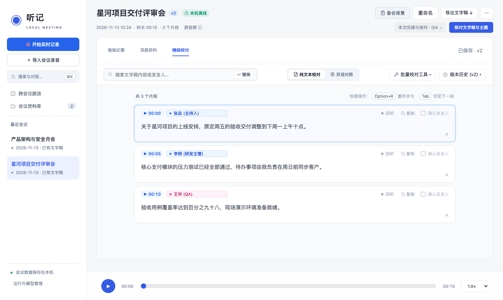
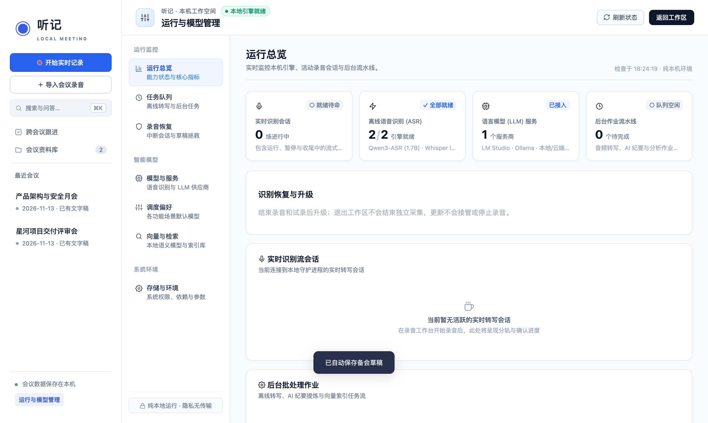

# 听记 · 本地会议工作台

> 面向 Apple Silicon Mac 的专业本地会议与访谈工作台。支持双轨原生音频采集、端侧实时语音转写、带原文证据链的智能纪要分析，以及完全离线的本地会议资料库。所有音频与会议数据均保存在本机。

---

## 界面一览


*图 1：会前准备与就绪舱 — 采集源试音检测、参会人与议程预设，以及会后整理目标与交付语言配置*


*图 2：智能纪要（单栏聚焦模式）— 紧凑双行会议头、行内交接核对入口，以及按议题组织的证据链结论*

| 双栏对照审阅 | 精细校对工作台 |
| :---: | :---: |
|  |  |
| *图 3：点击「对照原文」展开双栏视图，左侧原文回听与右侧纪要齐平联动* | *图 4：精细校对 — 搜索替换、纯文本/双语对照切换、批量校对工具与版本历史* |


*图 5：运行与模型管理 — 全局侧边栏导航串联运行总览、任务队列、录音恢复、模型与服务及存储环境*

---

## 核心特性

- **双轨原生采集与会前就绪舱**
  - 支持电脑系统声音与麦克风双轨独立采集，内置硬件级与 WebRTC AEC3 回声消除。
  - 会前提供采集源检测、声压测试与试录回放验证，并可预设会议主题、参会人、议程提纲与交付目标。
  - 原生提供置顶轻量伴随窗（快捷键 `Ctrl + Option + N`），录音状态一目了然且不遮挡主屏操作。

- **端侧多引擎实时与会后转写**
  - 支持中文、英文及实验性日语本地离线识别与说话人分离，音频无需外发。
  - 提供高速高精度的 **Whisper large-v3-turbo** 与针对口语优化的 **Qwen3-ASR (1.7B-8bit)** 引擎，支持会中实时流式出字与会后整轨精细补转写。
  - 自动运行 Pyannote 说话人分离、3DSpeaker 声纹特征对齐与上下文标点恢复。

- **三大聚焦会议工作区（单会议视图）**
  - 会议详情采用紧凑双行抬头与「识别覆盖 / 本次交接与核对」行内弹出清单，核心操作聚焦为三个主视图，并随时通过弹窗编辑**备会背景**：
    1. **智能纪要**：默认单栏聚焦阅读，支持一键「对照原文」进入双栏齐平回听；内置商务会议、头脑风暴、技术研讨及在线面试等模版，支持独立选择**中文 / English** 输出语言、版本历史对比（Diff View）及 Word (`.docx`) / PDF / Markdown 导出。
    2. **深度研判**：围绕会议记录进行质询与深度分析，结论严格锚定原文音轨片段与发言人身份，点击证据即可秒级定位回听。
    3. **精细校对**：集成高密度 Pro 工具栏，支持搜索与全局替换、`纯文本校对 / 双语对照`（含日语实验性会后原文与中文译文）切换、术语热词批量校对及版本回溯。

- **桌面级「运行与模型管理」控制中心**
  - 采用桌面侧边栏统一导航，将工作区与运行中心解耦：涵盖**运行总览**、**任务队列**、**录音恢复**、**模型与服务**、**调度偏好**、**向量与检索**及**存储与环境**。
  - 支持离线模型包导入与完整性校验、离线能力探测、服务状态诊断与意外中断录音自愈。

- **跨会议资料库与语义检索问答**
  - 会议按项目、标签与日期归档，持续跟踪跨场次行动项与责任人。
  - 基于本地向量库实现中英文关键词与语义检索，提供带引用来源与语言锁定的跨会议 AI 问答。

---

## 快速上手

### 方式一：下载预编译应用与模型包（推荐）

1. 从 Release 页面下载最新版本产物（提供 [Gitea 镜像](https://git.seeknow.cn:8010/crf/meeting-local/releases/tag/v0.4.0) 或 [GitHub Releases](https://github.com/rfchu/meeting-local/releases/tag/v0.4.0)）：
   - `Tingji-v0.4.0-macOS.zip`（原生 macOS 桌面工作台，解压后拖入 `/Applications` 即可运行）
   - `TingjiCapture-v0.4.0-macOS.zip`（双轨低延迟音频采集器）
   - `Tingji-Models-v0.1.0.zip`（完整端侧离线模型包，由于单文件体积限制以 1.8GB 分卷提供 `part-aa`、`part-ab`、`part-ac`）
2. 若下载了分卷模型包，可在终端合并为完整 ZIP：
   ```bash
   cat Tingji-Models-v0.1.0.zip.part-* > Tingji-Models-v0.1.0.zip
   ```
3. 打开 `Tingji.app`，进入「运行与模型管理 → 智能模型 → 模型与服务」，点击导入已合并的模型包 ZIP，即可完成端侧离线就绪。

### 方式二：本机源码运行（开发者）

#### 环境准备
- 操作系统：macOS 15.0+（推荐 Apple Silicon 芯片 M1/M2/M3/M4）
- 基础依赖：Python 3.12 或 3.13、Xcode Command Line Tools、FFmpeg

#### 启动服务
```bash
# 克隆仓库
git clone https://github.com/rfchu/meeting-local.git
cd meeting-local

# 初始化环境与依赖
bash scripts/setup.sh

# 启动后台服务
./service.command start
```

服务就绪后，在浏览器中访问 [http://127.0.0.1:8765/](http://127.0.0.1:8765/)，或直接构建并打开原生桌面宿主：
```bash
# 构建原生桌面宿主
bash scripts/build_host.sh

# 启动原生应用
open ~/Library/Caches/cn.seeknow.tingji/Tingji.app
```

#### 按需扩展与常用验证命令
- **Qwen3-ASR 扩展引擎**：`bash scripts/setup_qwen.sh`
- **原生双轨采集器构建**：`bash scripts/build_capture.sh`
- **前端依赖安装、检查与构建**：
  ```bash
  npm --prefix frontend ci
  npm --prefix frontend run typecheck
  npm --prefix frontend run test:stream
  npm --prefix frontend run build
  ```
- **后端与宿主回归测试**：
  ```bash
  pytest
  bash scripts/test_host.sh
  ```

---

## 模型与数据隐私

1. **音频与转写纯本地运行**：语音转写、说话人聚类、标点预测与声纹嵌入全部在 Mac 本机端侧芯片运行，无任何音频上传。
2. **AI 纪要与分析模型可选**：
   - 默认支持连接本地大模型（如 [LM Studio](https://lmstudio.ai/) 或 [Ollama](https://ollama.ai/)），实现 100% 离线脱网运行。
   - 亦可按需在「运行与模型管理 → 智能模型 → 模型与服务」配置商业 OpenAI 兼容 HTTPS API。使用云端模型前需经用户明确确认，且仅提交文字稿与提纲。
3. **数据自主可控**：会议数据库及所有音频原件保存在 `data/` 目录，支持离线备份与无损物理迁移。

---

## 技术架构

- **前端应用与设计系统**：React 19 + TypeScript + Vite 7 + TanStack Query + TanStack Virtual；基于 `tokens.css` 语义设计令牌与 `shellState` 全局导航状态机，构建统一桌面 App Shell（固定侧边栏 + 紧凑会议头 + 三大聚焦工作区）。
- **后端服务与数据存储**：Python + FastAPI + SQLite（WAL 模式 + `sqlite-vec` 本地向量检索）+ Uvicorn。
- **端侧模型与推理引擎**：`whisper.cpp`（Metal 加速）+ `MLX`（Qwen3-ASR）+ `Silero VAD` + `sherpa-onnx`（Pyannote / 3DSpeaker）。
- **macOS 桌面原生宿主**：Swift 5 + AppKit + WebKit + ScreenCaptureKit（原生系统音频捕获、伴随窗与离线运维）。

---

## 文档索引

- [项目文档总览](docs/README.md)
- [用户使用指南](docs/USER_GUIDE.md)
- [UI 与布局架构设计地图](docs/specs/MAP-ui-architecture-redesign.md)
- [开发与验证指南](docs/engineering/DEVELOPMENT.md)
- [本机维护与数据迁移](docs/engineering/WORKSPACE.md)
- [模型包设计规格](docs/specs/SPEC-model-packs.md)
- [产品规划路线图](docs/PROJECT_ROADMAP.md)

---

## 开源许可

本项目源码采用 MIT 许可。所包含或下载的第三方模型与工具（如 Whisper、Qwen、Pyannote、Sherpa-ONNX、FFmpeg 等）遵循各自的开源许可协议。
